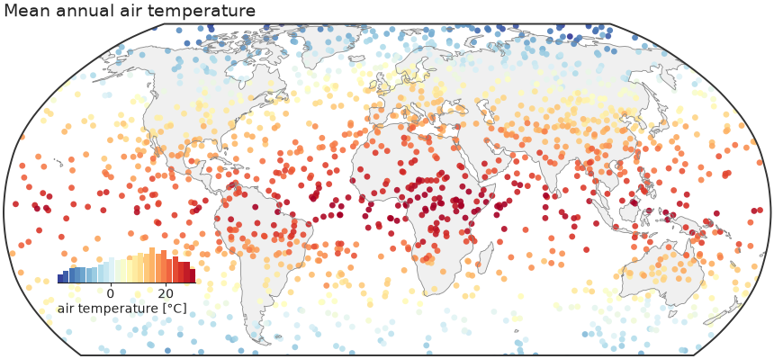
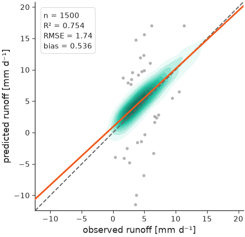
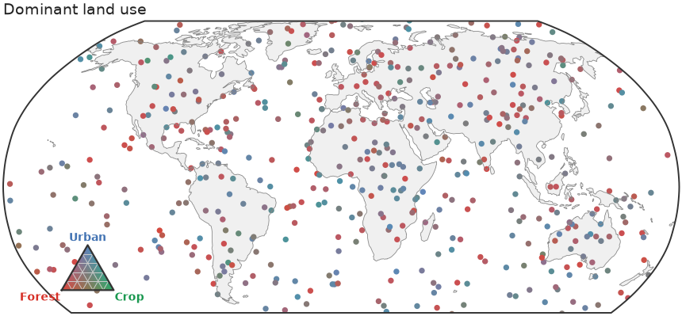
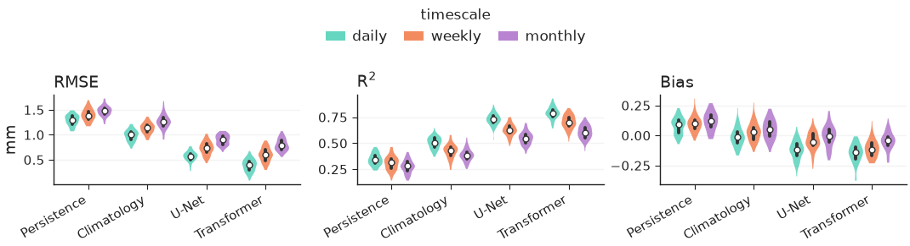
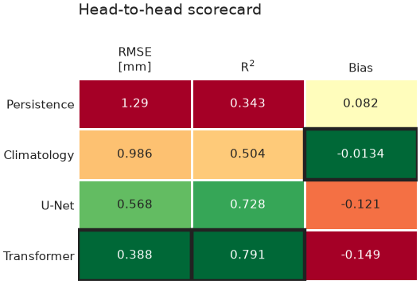
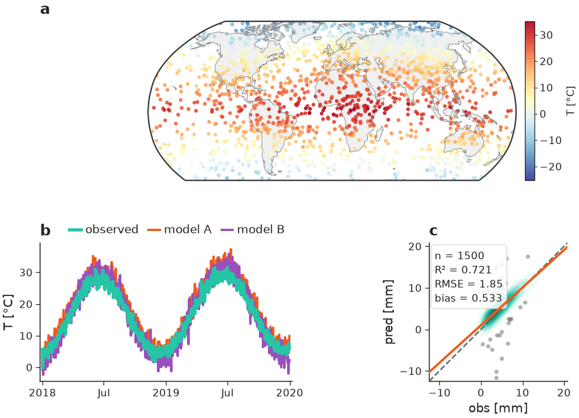

<p align="center">
  <picture>
    <source media="(prefers-color-scheme: dark)" srcset="https://raw.githubusercontent.com/EarthyScience/nicefigs/main/docs/assets/logo/nicefigs-lockup-dark.svg">
    
  </picture>
</p>

<p align="center"><b>Publication-grade, modular matplotlib plotting for geoscience.</b></p>

<p align="center">
  <a href="https://pypi.org/project/nicefigs/"></a>
  <a href="https://pypi.org/project/nicefigs/"></a>
  <a href="https://github.com/EarthyScience/nicefigs/actions/workflows/ci.yml"></a>
  <a href="https://earthyscience.github.io/nicefigs"></a>
  <a href="LICENSE"></a>
</p>

`nicefigs` is a thin, composable layer on top of matplotlib for figures in
geoscience papers. It provides one consistent house style, **physical figure
sizing** that keeps fonts at their point sizes across every panel, and
ready-made plots for the figures geoscientists draw most: global and regional
maps, agreement plots, model comparisons, scorecards, time series, ternary
compositions, verification diagrams and map animations.

Every helper takes an existing `ax` where that makes sense, so nicefigs pieces
drop into your own matplotlib layouts.

## Gallery

<table>
  <tr>
    <td width="50%"></td>
    <td width="50%"></td>
  </tr>
  <tr>
    <td></td>
    <td></td>
  </tr>
  <tr>
    <td></td>
    <td></td>
  </tr>
</table>

The [gallery](https://earthyscience.github.io/nicefigs/gallery/) shows every
plot type with the code that drew it.

## Install

```bash
pip install nicefigs              # core: matplotlib, numpy, scipy, pillow
pip install "nicefigs[maps]"      # + cartopy map projections and ocean clipping
pip install "nicefigs[all]"       # + cartopy and xarray
```

Python 3.10 or newer. Without cartopy, maps fall back to a plain
equirectangular axes.

## Quick start

```python
import nicefigs as nf
from nicefigs import data          # deterministic synthetic example data

nf.set_theme("paper")

# A single-column figure; the height is solved from the aspect.
fig, ax = nf.subplots(width="single", aspect=0.8)

obs, pred = data.xy_agreement()
nf.agreement(obs, pred, ax=ax, units="mm d⁻¹")   # KDE density, 1:1 line, fit, metrics
nf.save(fig, "agreement", formats=("pdf", "png"))
```

A global map with an inset-histogram colorbar:

```python
import nicefigs as nf
from nicefigs import data

lon, lat, temp = data.global_points(field="temperature")
fig, ax, mappable = nf.map(lon, lat, temp, cmap="RdYlBu_r", colorbar_label="T [°C]")
```

## Features

- **One house style.** `set_theme("paper" | "paper-large" | "talk" | "poster")`
  globally, or `with nf.style(...):` around existing matplotlib code.
- **Physical figure sizing.** `width="single"`, `"double"`, `"slide"`, …
  plus an aspect; the free dimension is solved and fonts stay at their point sizes.
- **Maps.** Robinson by default with Antarctica cropped, an inset histogram that
  doubles as the colorbar, ocean clipping, point, binned, raster, categorical
  and triangulated rendering, and regional extents.
- **Colour.** Geoscience colormaps and diverging norms, land-cover palettes
  (ESA WorldCover, ESRI, MODIS), a role palette for comparison figures, artist
  palettes, ternary and bivariate 2D colormaps with matching legends.
- **Evaluation plots.** Agreement plots, model-comparison violins, Taylor
  diagrams, scorecards with a skill-gap colouring, Pareto frontiers,
  caterpillar plots, reliability diagrams, rank histograms and
  precision–recall curves.
- **Structure in space and time.** Time series with ensemble bands,
  Hovmöller diagrams, cross-sections and vertical profiles, map animations to
  MP4 or GIF.
- **Layout helpers.** Panel labels, tight shared colorbars, facets, row and
  column labels, and `check_text_overlaps` to catch colliding text before
  submission.

## Documentation

The full documentation, with a user guide and the API reference, is at
<https://earthyscience.github.io/nicefigs>.

## Contributing

```bash
git clone https://github.com/EarthyScience/nicefigs
cd nicefigs
uv venv && uv pip install -e ".[dev,docs]" && uv run pre-commit install
make check          # pre-commit + tests, exactly what CI runs
make gallery        # re-render docs/gallery and the README images
make docs-check     # run every README/docs code example against its shown output
```

See [RELEASING.md](RELEASING.md) for how a release is cut.

## License

MIT — see [LICENSE](LICENSE).
