# Gallery

Every example below is a full, runnable script under `examples/` in the
repository (`examples/NN_*.py`), each producing exactly one image in this
gallery. All example data comes from `nicefigs.data`: deterministic,
numpy-only synthetic fields, so the gallery, docs and tests draw the same
figures from the same data.

## Maps

### 01 — Global map {#global-map}

The house default: [`nicefigs.map`][nicefigs.map] scatters per-station
values on a Robinson world map, crops Antarctica, and draws
an inset histogram that doubles as the colorbar and shows the data
distribution.

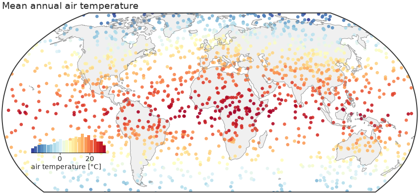

```python
--8<-- "examples/01_global_map.py"
```

### 02 — Anomaly map (binned) {#anomaly-map}

For dense fields, `kind="binned"` bin-averages onto a regular grid and masks
the ocean. `diverging=True` picks a diverging colormap and symmetric limits
about zero — the right default for anomalies.

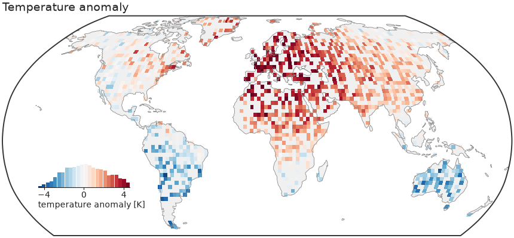

```python
--8<-- "examples/02_anomaly_map.py"
```

### 03 — Regional map {#regional-map}

A bounded extent on a Plate Carrée axes with a slim colorbar instead of the
inset histogram.

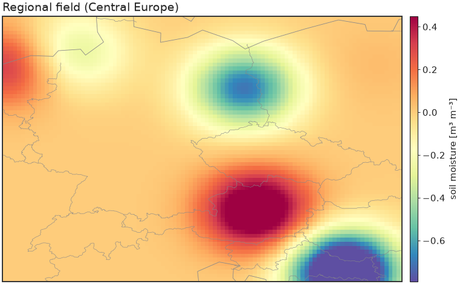

```python
--8<-- "examples/03_regional_map.py"
```

### 04 — Shared colorbar across subplots {#shared-colorbar}

One colorbar serves a whole row of maps (no repetition), and the
`with nf.style(...)` context manager restyles otherwise-plain matplotlib
code — drop it on top of anything.

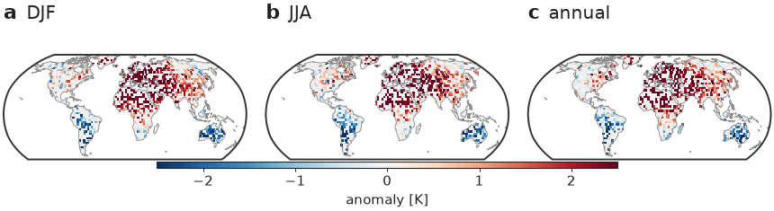

```python
--8<-- "examples/04_shared_colorbar.py"
```

### 05 — Ternary map {#ternary-map}

A global/regional map whose points are coloured by a 3-part composition, with
a triangular legend inset that decodes the colours.

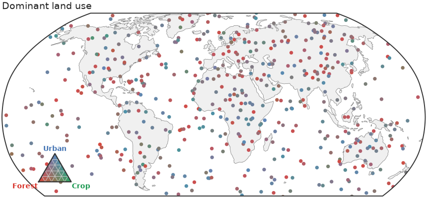

```python
--8<-- "examples/05_ternary_map.py"
```

### 06 — Bivariate colormap {#bivariate}

[`nicefigs.colormaps2d`][nicefigs.colormaps2d] encodes *two* continuous
variables in one colour via a 2D palette — here [`bivariate_cmap`][nicefigs.bivariate_cmap]
(a 4-corner bilinear blend), decoded by a square
[`bivariate_legend`][nicefigs.bivariate_legend] inset.
[`hsv_cmap`][nicefigs.hsv_cmap] and [`flat_cmap`][nicefigs.flat_cmap] (a
constant-lightness CIE-Lab wheel) are drop-in alternatives with their own
`hsv_legend`/`flat_legend`.

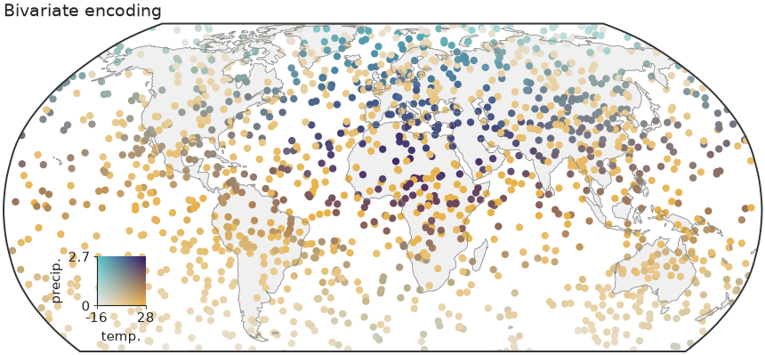

```python
--8<-- "examples/06_bivariate.py"
```

## Images & colormaps

### 07 — Image grid {#image-grid}

Several heatmaps on a shared colour scale with one colorbar for the whole
grid.

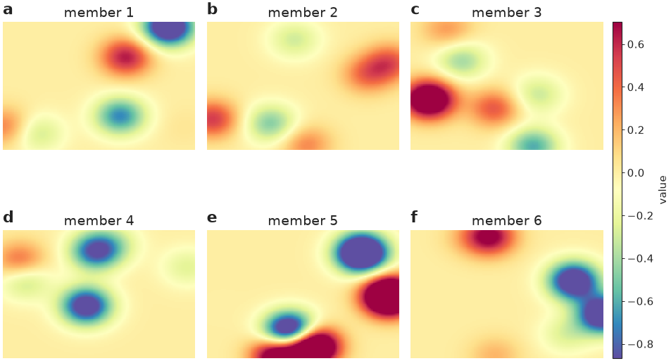

```python
--8<-- "examples/07_image_grid.py"
```

### 08 — RGB imagery & land cover {#landcover-rgb}

Natural-colour imagery next to a categorical land-cover raster with a
geospecific palette and matching legend.

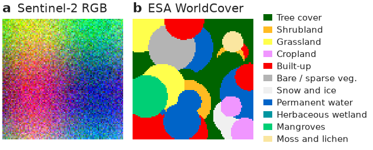

```python
--8<-- "examples/08_landcover_rgb.py"
```

### 09 — Annotated heatmap {#heatmap}

A labelled heatmap with row/column labels, cell annotations, and a tight
colorbar.

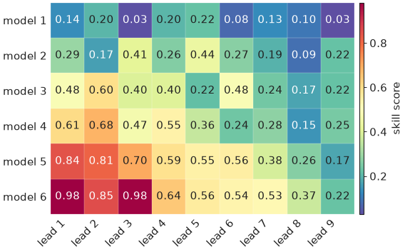

```python
--8<-- "examples/09_heatmap.py"
```

### 10 — Elevation colormap {#elevation}

A geoscience-specific colormap: a hypsometric elevation ramp with a
sea-level break, built by [`elevation_cmap`][nicefigs.elevation_cmap].

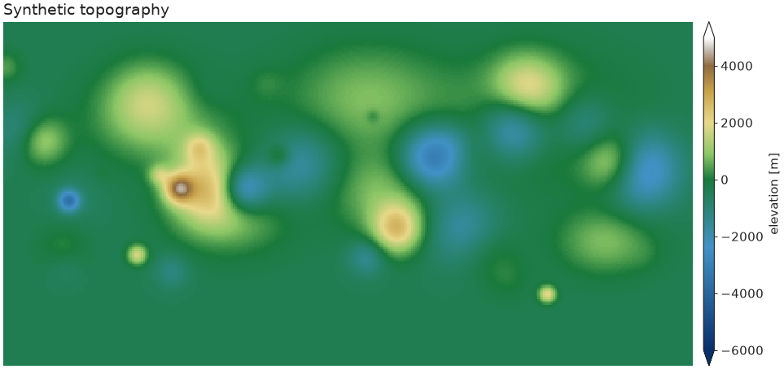

```python
--8<-- "examples/10_elevation.py"
```

### 11 — Ternary scatter {#ternary-scatter}

A composition `(a, b, c)` with `a + b + c = 1` — here soil texture — encoded
as colour by blending three corner colours barycentrically, scattered inside
a triangular frame.

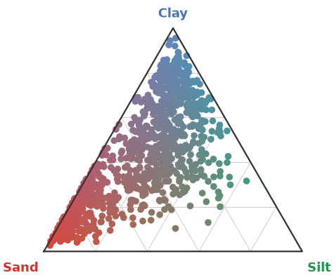

```python
--8<-- "examples/11_ternary.py"
```

### 12 — Artist-inspired palettes {#artist-palettes}

Painterly categorical palettes ported from
[MetBrewer](https://github.com/BlakeRMills/MetBrewer) and
[MoMAColors](https://github.com/BlakeRMills/MoMAColors)
([`artist_palette`][nicefigs.artist_palette]), plus two bespoke categorical
bases extracted from David Hockney's *A Bigger Grand Canyon* (1998):
[`HOCKNEY_CANYON`][nicefigs.artists.HOCKNEY_CANYON] ("hockney"), wired into
[`cmap("hockney_canyon")`][nicefigs.cmap] as a continuous colormap
([`artist_cmap`][nicefigs.artist_cmap]); and
[`NICE`][nicefigs.NICE] ("nice") — a bright teal leading the same Hockney
family — which is the **house default** categorical cycle, used by every
theme and by [`qualitative()`][nicefigs.qualitative] whenever no `palette`
is given.

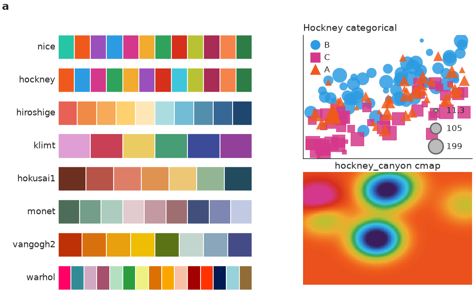

```python
--8<-- "examples/12_artist_palettes.py"
```

## Composition

The same barycentric colour encoding — [`nicefigs.ternary.color`][nicefigs.ternary.color] —
underlies every ternary helper, which is what lets it drop onto different
plot kinds without change: [example 11](#ternary-scatter) applies it to a
scatter inside a triangular frame ([`ternary_scatter`][nicefigs.ternary_scatter]),
while [example 05](#ternary-map) applies the identical encoding to points on
a global map ([`ternary_map`][nicefigs.ternary_map]), reusing
[`ternary_legend`][nicefigs.ternary_legend] as the inset in both cases. This
is the composability nicefigs is built around: small helpers that all take
an existing `ax`, so they combine freely instead of each owning a whole
figure. See the [Composite figure](#composite) below for the same idea
applied across map, timeseries, and agreement panels in one `GridSpec`.

## Relational & distributions

### 13 — Multi-encoding scatter {#scatter}

Marker *shape* (a categorical group), *size* (a continuous variable), and
*colour* map onto up to three extra variables, with a compact legend for
each.

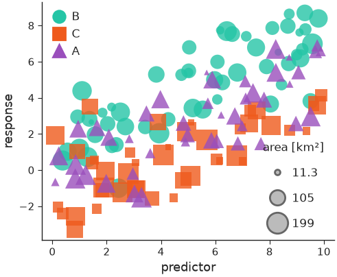

```python
--8<-- "examples/13_scatter.py"
```

### 14 — Agreement plot {#agreement}

The house predicted-vs-observed plot: a KDE density of the bulk of the cloud,
a dashed 1:1 line, outliers as faint scatter, a solid regression line, and a
compact metrics box (n, R², RMSE, bias).

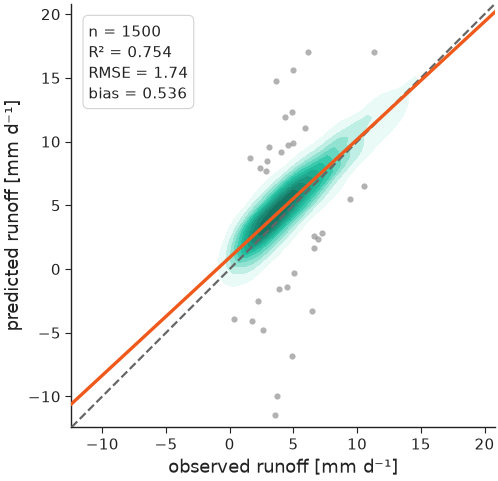

```python
--8<-- "examples/14_agreement.py"
```

### 15 — Timeseries {#timeseries}

Observations vs. models with an uncertainty band and a date axis that adapts
its ticks/format to the observed time span.

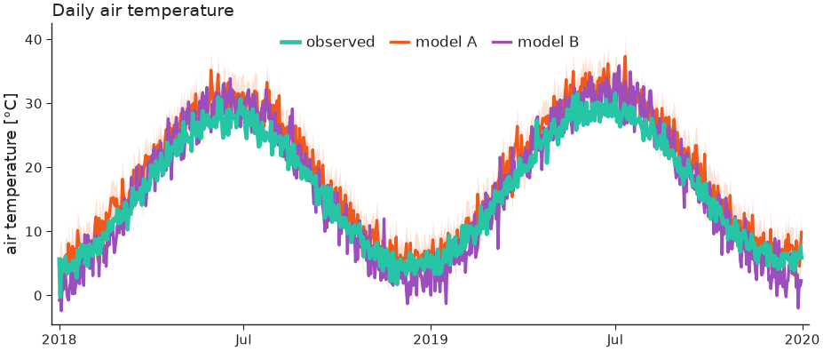

```python
--8<-- "examples/15_timeseries.py"
```

### 16 — Faceted station timeseries {#station-timeseries}

Small-multiples of per-station model curtains with a sparse observation
overlay, built from [`nicefigs.facet`][nicefigs.facet] (one call per panel,
consistent physical sizing) plus [`timeseries`][nicefigs.timeseries]'s
`obs=` overlay, per-series `styles`, and a per-panel `annotation`.

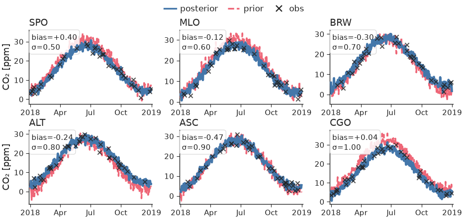

```python
--8<-- "examples/16_station_timeseries.py"
```

### 32 — Eigen-spectra {#spectrum}

[`nicefigs.spectrum`][nicefigs.spectrum] plots covariance eigenvalue spectra
against rank on log–log axes (left, with a `k^-1` reference power law) or as
cumulative explained variance with markers where each series reaches 50, 90
and 99 % (right). Numerically zero tails are dropped.

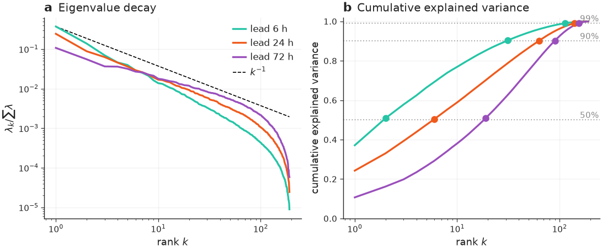

```python
--8<-- "examples/32_spectrum.py"
```

## Comparison & ranking

### 17 — Model comparison {#model-comparison}

One panel per metric, a violin per model, dodged by an optional group (e.g.
timescale), with a single shared legend.

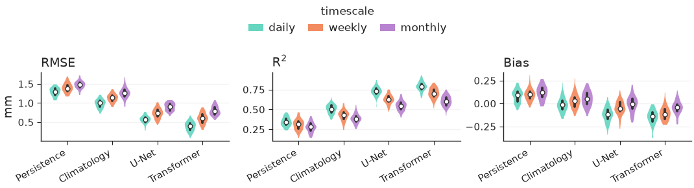

```python
--8<-- "examples/17_model_comparison.py"
```

### 18 — Pareto frontier {#pareto}

[`nicefigs.pareto`][nicefigs.pareto] scatters a trade-off (here speed vs.
skill) with the non-dominated [`frontier`][nicefigs.frontier] drawn per
group, arrows from `xdirection`/`ydirection` on the axis labels showing which
way is better, and labelled `baselines` as reference lines.

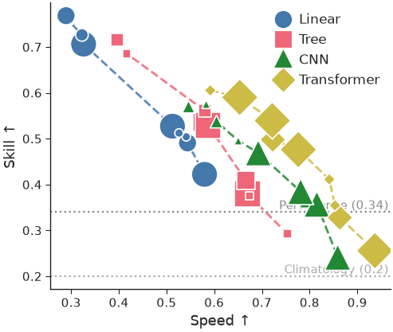

```python
--8<-- "examples/18_pareto.py"
```

### 19 — Caterpillar / forest plot {#caterpillar}

[`nicefigs.caterpillar`][nicefigs.caterpillar] ranks per-item values ± error
(here per-site bias ± σ), with an optional `baseline` series offset alongside
each item, a reference line at the null, and a headline `summary` annotation.

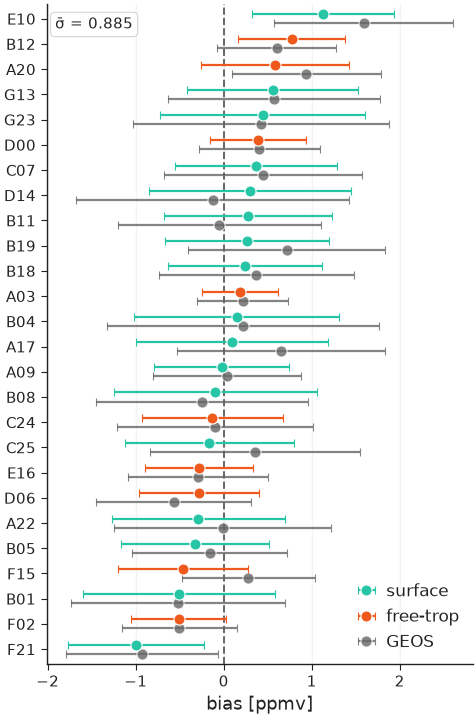

```python
--8<-- "examples/19_caterpillar.py"
```

### 20 — Scorecard {#scorecard}

[`nicefigs.scorecard`][nicefigs.scorecard] renders a model×metric table as
coloured cells — normalised independently per column and respecting each
metric's `direction` (lower/higher better) — with the best model per metric
outlined.

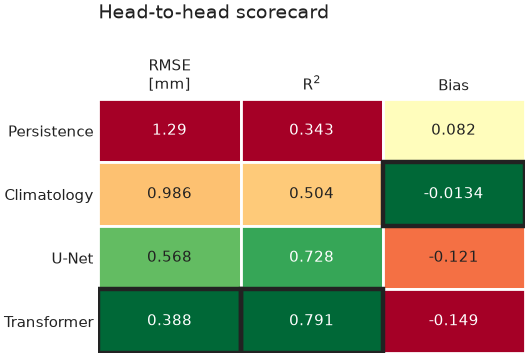

```python
--8<-- "examples/20_scorecard.py"
```

### 21 — Grouped & stacked bars {#bars}

[`nicefigs.grouped_bars`][nicefigs.grouped_bars] dodges one bar per
`(category, series)`; [`nicefigs.stacked_bars`][nicefigs.stacked_bars]
stacks series within each category (`normalize=True` for fractions) —
both take a plain `ax` so they drop into any layout.

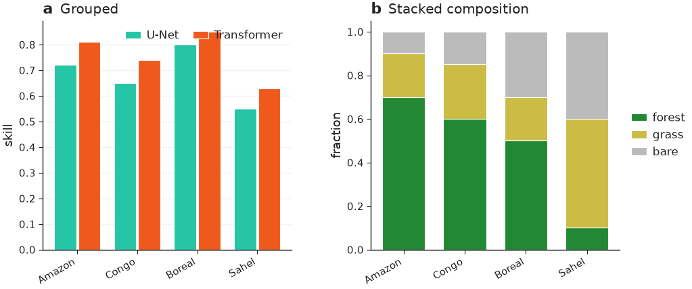

```python
--8<-- "examples/21_bars.py"
```

### 30 — Scorecard, diverging {#scorecard-diverging}

[`nicefigs.scorecard`][nicefigs.scorecard]'s opt-in kwargs for a
WeatherBench2-style skill scorecard: an explicit diverging `norm` (here
[`scorecard_diverging_cmap`][nicefigs.scorecard_diverging_cmap]) colours
cells by their *actual* percent-difference value anchored at zero instead of
per-column goodness ranking; `col_groups` clusters columns with a gap and a
group title; `square=True` forces square cells; `colorbar=True` draws a
horizontal bar with the colormap's extend triangles.

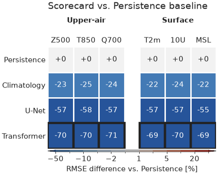

```python
--8<-- "examples/30_scorecard_diverging.py"
```

## Vertical structure

### 22 — Cross-section / curtain {#cross-section}

[`nicefigs.cross_section_panels`][nicefigs.cross_section_panels] lays out
several latitude×pressure curtains ([`cross_section`][nicefigs.cross_section]
per panel) with shared value/difference colorbars — `diff_fields` routes named
fields onto a symmetric, diverging scale, and `log_y` log-scales the vertical
(pressure) axis.

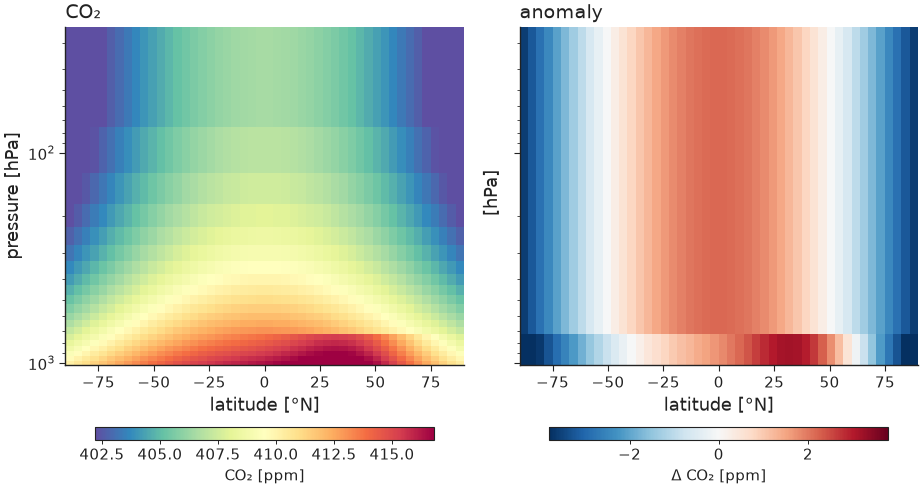

```python
--8<-- "examples/22_cross_section.py"
```

## Composite & animation

### 23 — Composite publication figure {#composite}

Shows the pieces composing: a `GridSpec` from [`nicefigs.grid`][nicefigs.grid]
(a projected map panel plus two analysis panels), a colorbar hugging the map,
and `(a) (b) (c)` panel labels — all at a single physical width so fonts stay
consistent across every panel, whether it's a map, a timeseries, or a scatter
plot.

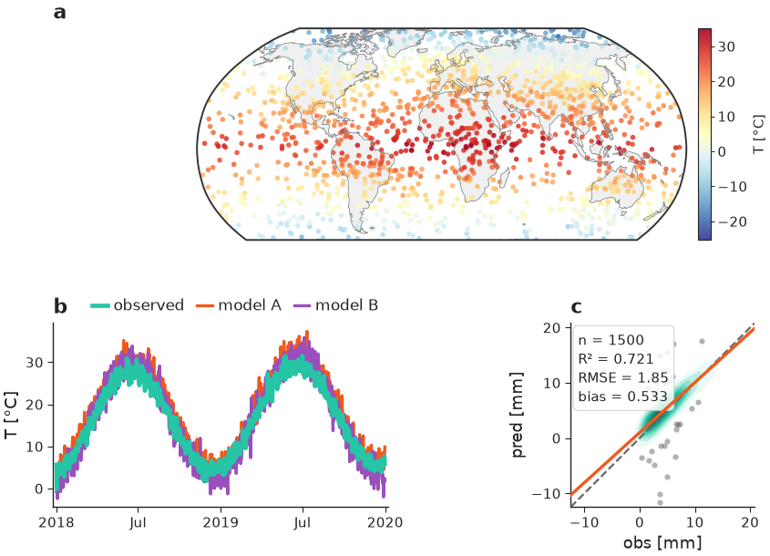

```python
--8<-- "examples/23_composite_figure.py"
```

### 24 — Map animation {#animation}

A drifting field animated over a fixed colour scale (computed once across all
frames so colours are comparable frame-to-frame), saved to GIF.

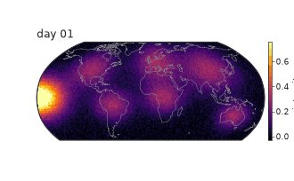

```python
--8<-- "examples/24_animation.py"
```

## Model evaluation & time–space

### 25 — Taylor diagram {#taylor}

[`nicefigs.taylor`][nicefigs.taylor] summarises correlation, standard
deviation and centred RMS difference against a reference in one polar plot — the
standard one-glance model-evaluation chart. Pass one entry per model with a
correlation and either an absolute `std` or a normalised `std_ratio`.

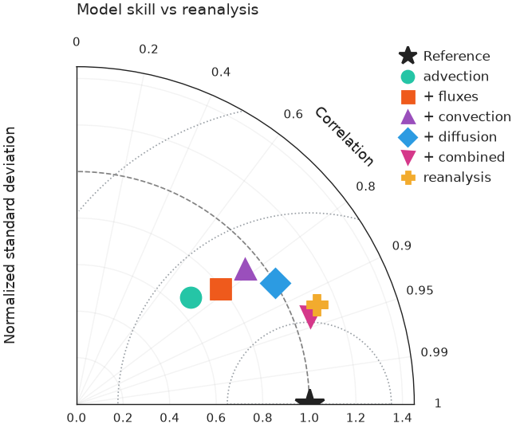

```python
--8<-- "examples/25_taylor.py"
```

### 26 — Hovmöller diagram {#hovmoller}

[`nicefigs.hovmoller`][nicefigs.hovmoller] plots a field over one spatial
coordinate and time; [`nicefigs.hovmoller_panels`][nicefigs.hovmoller_panels]
lays out model, reference and their difference with shared value / difference
colorbars. The time axis accepts numbers or `datetime` objects.

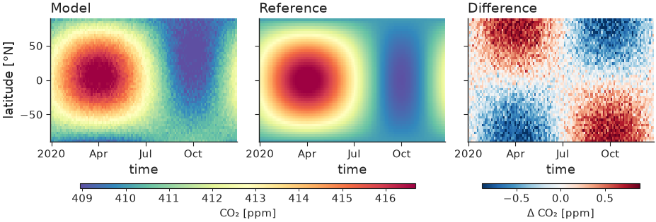

```python
--8<-- "examples/26_hovmoller.py"
```

### 27 — Vertical profile {#profile}

[`nicefigs.profile`][nicefigs.profile] is the 1-D companion to
`cross_section`: several profiles (value vs level/pressure) with an inverted,
optionally log-scaled vertical axis and dashed baselines.

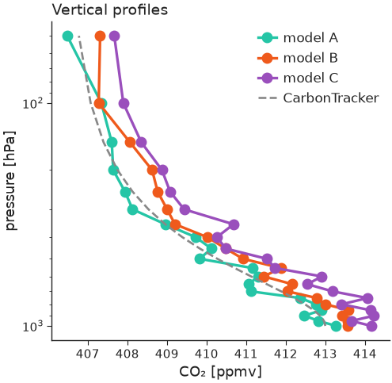

```python
--8<-- "examples/27_profile.py"
```

### 28 — Frame-based animation engine {#render-animation}

[`nicefigs.render_animation`][nicefigs.render_animation] renders each frame
with your own `draw(i) -> Figure` callback and stitches them with
[`nicefigs.stitch_frames`][nicefigs.stitch_frames] (MP4 via ffmpeg, GIF
fallback). A frame can be anything — here a field snapshot **and** a running
timeseries side by side, which `animate_maps` alone can't do. Pass
`method="parallel"` to fan the frames out across CPU cores for large or
expensive animations.

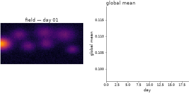

```python
--8<-- "examples/28_render_animation.py"
```

### 29 — Timeseries with hue-mapped observations {#timeseries-obs-hue}

[`timeseries`][nicefigs.timeseries]'s sparse `obs=` overlay can be coloured
by a third variable via `obs_hue` (e.g. sample altitude) instead of the flat
`obs_color`, with `obs_colorbar=True` drawing a slim colorbar for it. The
legend still gets one proxy handle for the overlay, not one per point.

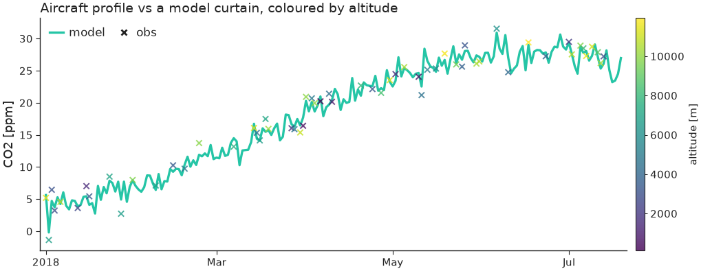

```python
--8<-- "examples/29_timeseries_obs_hue.py"
```

### 31 — Panel label composed with an existing title {#panel-label-with-title}

[`label_panels`][nicefigs.label_panels]'s `use_ax_title=True` picks up each
panel's own `ax.set_title()` (as set by [`hovmoller_panels`][nicefigs.hovmoller_panels]
here) and redraws it next to the bold letter at one height, instead of
leaving matplotlib's separately-positioned title floating at its own default
spot.

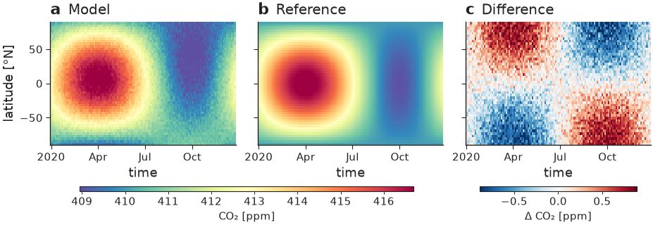

```python
--8<-- "examples/31_panel_label_with_title.py"
```
