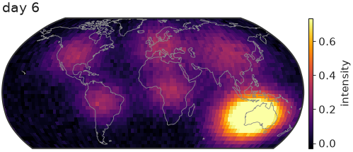
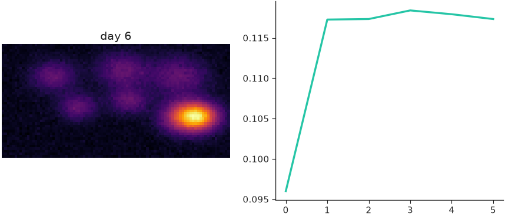

# Animation

nicefigs animates maps in two ways: [`animate_maps()`][nicefigs.animate_maps]
for one map over a stack of frames, and
[`render_animation()`][nicefigs.render_animation] for frames you draw yourself.

## Animating a stack of maps

[`animate_maps()`][nicefigs.animate_maps] builds a
`matplotlib.animation.FuncAnimation` over a `(T, H, W)` stack of frames, on a
projected map (`as_map=True`, the default) or a plain image axes. It returns
`(fig, ax, anim)`:

```python
import nicefigs as nf
from nicefigs import data

nf.set_theme("paper")

lon, lat, frames = data.map_timeseries_cube(n_frames=6, shape=(45, 90))
fig, ax, anim = nf.animate_maps(
    lon, lat, frames,
    cmap="inferno",
    titles=[f"day {i + 1}" for i in range(len(frames))],
    colorbar_label="intensity",
    width="half",
)
print(nf.save_animation(anim, "drift.gif", fps=4, dpi=60).name)
```

```text
drift.gif
```



The colour scale is computed once across all frames — robust percentiles by
default, symmetric limits with `diverging=True` — so a colour means the same
value in every frame, and one colorbar serves them all.

Pass `extent=(west, east, south, north)` for a regional map, the same
convention as [`map()`][nicefigs.map], or `as_map=False` to animate an image
stack without a geographic projection.

## Saving

[`save_animation()`][nicefigs.save_animation] writes a `.gif` with Pillow and
any other suffix, such as `.mp4`, with `ffmpeg`. It returns the path it wrote.

!!! note
    Without `ffmpeg`, or if `ffmpeg` fails, an `.mp4` request silently writes a
    `.gif` next to it instead. Use the returned path, not the one you passed.

## Drawing every frame yourself

[`render_animation()`][nicefigs.render_animation] calls a `draw(i) -> Figure`
callback per frame, so a frame can hold several panels or anything else
matplotlib draws. It saves and closes each figure, then stitches the frames:

```python
import numpy as np

import nicefigs as nf
from nicefigs import data

nf.set_theme("paper")

lon, lat, frames = data.map_timeseries_cube(n_frames=6, shape=(45, 90))
mean = frames.reshape(len(frames), -1).mean(axis=1)


def draw(i):
    fig, axes = nf.subplots(1, 2, width="full", panel_aspect=0.8)
    nf.image(frames[i], cmap="inferno", title=f"day {i + 1}", ax=axes[0])
    axes[1].plot(np.arange(i + 1), mean[: i + 1])
    return fig


path = nf.render_animation(draw, len(frames), "panels.gif", fps=4, dpi=60, max_workers=2)
print(path.name)
draw(len(frames) - 1)  # the last frame, shown below
```

```text
panels.gif
```



`method="parallel"`, the default, renders frames in a process pool, which pays
off once frames are many or slow to draw. It needs a picklable `draw`: a
module-level function or a `functools.partial` of one, not a lambda or a
closure. Use `method="sequential"` otherwise.

!!! note
    On macOS and Windows, worker processes are started with the *spawn*
    method: each one re-imports your script. Put the call to
    `render_animation(..., method="parallel")` under an
    `if __name__ == "__main__":` guard, or every worker re-runs it. In a
    notebook or an interactive session there, `draw` must also come from an
    importable module; otherwise use `method="sequential"`. Linux forks its
    workers and needs neither.

## Stitching frames rendered elsewhere

[`stitch_frames()`][nicefigs.stitch_frames] turns a directory of
`frame_000000.png`, `frame_000001.png`, … into an MP4 (`ffmpeg`, libx264,
padded to even dimensions) or a GIF, with the same fallback as
[`save_animation()`][nicefigs.save_animation]:

```python
from pathlib import Path

import matplotlib.pyplot as plt

import nicefigs as nf

nf.set_theme("paper")

Path("frames").mkdir(exist_ok=True)
for i in range(4):
    fig, ax = nf.subplots(width="third", aspect=1.0)
    ax.plot([0, 1], [0, i])
    fig.savefig(f"frames/frame_{i:06d}.png", dpi=60)
    plt.close(fig)

print(nf.stitch_frames("frames", "movie.gif", fps=4).name)
```

```text
movie.gif
```
