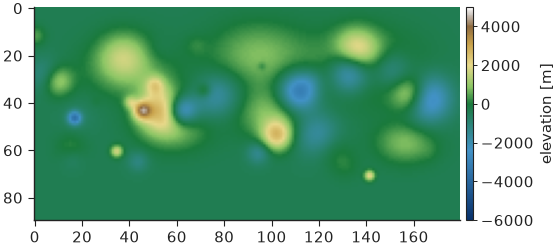
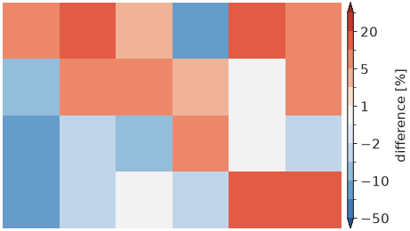
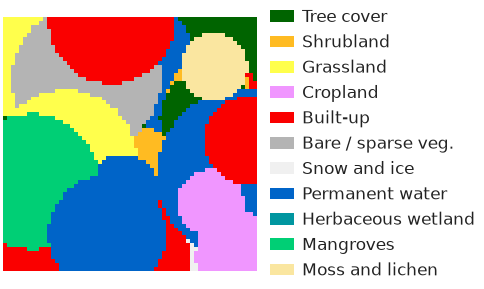
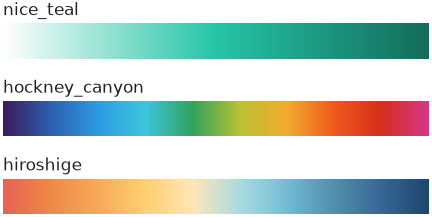
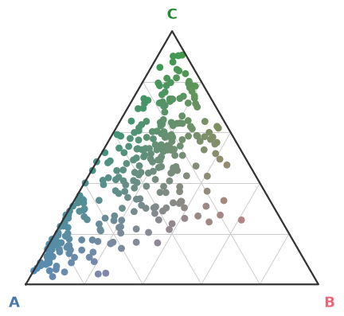
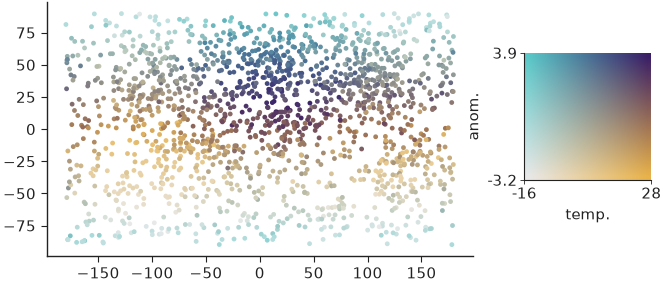

# Colormaps & palettes

Every colour helper resolves by name: [`cmap()`][nicefigs.cmap] for continuous
colormaps, [`categorical()`][nicefigs.categorical] for class-code rasters,
[`qualitative()`][nicefigs.qualitative] and
[`artist_palette()`][nicefigs.artist_palette] for lists of distinct colours.
Unknown names raise `KeyError`. Examples that draw set the house style with
`nf.set_theme("paper")`.

## Resolving continuous colormaps

[`DEFAULTS`][nicefigs.DEFAULTS] maps a *kind of data* to a colormap.
`cmap(name, n=None)` resolves such a kind, a matplotlib name (case-insensitive)
or a `Colormap`, and resamples it to `n` levels if asked:

```python
import nicefigs as nf

print(nf.DEFAULTS["diverging"], nf.DEFAULTS["intensity"])
print(nf.cmap("spectral_r").name)
print(nf.cmap("diverging").name)
print(nf.cmap("viridis", n=8).N)
```

```text
RdBu_r inferno
Spectral_r
RdBu_r
8
```

Name a kind (`"diverging"`, `"sequential"`, `"cyclic"`) rather than a
colormap, and every figure of one kind changes together.

## Centring diverging data

For anomalies centred on a meaningful value,
[`symmetric_limits()`][nicefigs.symmetric_limits] returns `(-m, m)` from a
robust percentile of `|values|`, [`robust_limits()`][nicefigs.robust_limits]
returns percentile limits, and [`diverging_norm()`][nicefigs.diverging_norm]
builds a `TwoSlopeNorm` around `center`:

```python
import numpy as np

import nicefigs as nf

anomaly = np.random.default_rng(0).normal(0.3, 1.0, 5000)
lo, hi = nf.symmetric_limits(anomaly)
norm = nf.diverging_norm(lo, hi, center=0.0)
print(f"{lo:.2f} {hi:.2f}", f"{norm(0.0):.2f}")
print([f"{v:.2f}" for v in nf.robust_limits(anomaly)])
```

```text
-2.42 2.42 0.50
['-1.71', '2.34']
```

Zero maps to the middle of the colormap even though the data are skewed.
[`map(..., diverging=True)`][nicefigs.map] uses the same limits.

## Elevation colormap

[`elevation_cmap()`][nicefigs.elevation_cmap] returns a hypsometric
`(cmap, norm)` pair — blues below `sea_level`, green to tan to white above —
with the norm placing `sea_level` exactly at the land/sea break for any
`vmin`/`vmax`:

```python
import nicefigs as nf
from nicefigs import data

nf.set_theme("paper")

elevation = data.elevation_field(shape=(90, 180))
cmap, norm = nf.elevation_cmap(vmin=-6000, vmax=5000)
fig, ax = nf.subplots(width="half", aspect=0.55)
im = ax.imshow(elevation, cmap=cmap, norm=norm)
nf.colorbar(im, ax, label="elevation [m]")
print(f"{norm(0.0):.3f}")
```

```text
0.545
```



## Banded scorecard colormap

[`scorecard_diverging_cmap()`][nicefigs.scorecard_diverging_cmap] returns a
`(cmap, norm)` pair for percent differences: 11 discrete, quasi-logarithmic
bands over [`SCORECARD_DIVERGING_BOUNDARIES`][nicefigs.SCORECARD_DIVERGING_BOUNDARIES],
a light-grey centre band, and distinct colours beyond ±50 %:

```python
import numpy as np

import nicefigs as nf

nf.set_theme("paper")

cmap, norm = nf.scorecard_diverging_cmap()
print(nf.SCORECARD_DIVERGING_BOUNDARIES)
pct_diff = np.random.default_rng(1).normal(0, 15, (4, 6))
fig, ax = nf.subplots(width="half", aspect=0.6)
im = ax.imshow(pct_diff, cmap=cmap, norm=norm)
ax.set_axis_off()
nf.colorbar(im, ax, extend="both", label="difference [%]")
```

```text
[-50, -20, -10, -5, -2, -1, 1, 2, 5, 10, 20, 50]
```



The narrow bands near zero keep differences of a few percent apart, where a
linear ±100 % scale would render them all as near-white.

## Land-cover palettes

[`categorical(name)`][nicefigs.categorical] returns a
[`Categorical`][nicefigs.Categorical] — class codes mapped to names and colours
— from [`CATEGORICAL`][nicefigs.CATEGORICAL]: `"esa_worldcover"`,
`"esri_lulc"` and `"modis_igbp"`. It gives a `(cmap, norm)` pair for
`imshow`, an RGB image, and legend patches:

```python
import nicefigs as nf
from nicefigs import data

nf.set_theme("paper")

lc = nf.categorical("esa_worldcover")
codes = data.landcover_patch(size=64)
cmap, norm = lc.cmap_norm()
fig, ax = nf.subplots(width="half", aspect=0.6)
ax.imshow(codes, cmap=cmap, norm=norm)
ax.set_axis_off()
ax.legend(handles=lc.legend_handles(), loc="center left", bbox_to_anchor=(1.0, 0.5),
          frameon=False, fontsize=6)
print(sorted(nf.CATEGORICAL), lc.to_rgb(codes).shape)
```

```text
['esa_worldcover', 'esri_lulc', 'modis_igbp'] (64, 64, 3)
```



## Qualitative and artist palettes

[`qualitative(n, palette="nice")`][nicefigs.qualitative] returns `n` distinct
colours, cycling past the palette length. The default `"nice"` palette
([`NICE`][nicefigs.NICE]) is a bright teal ahead of colours sampled from David
Hockney's *A Bigger Grand Canyon*; it is also every theme's colour cycle.
`"bright"`, `"muted"` and `"high_contrast"` are Paul Tol's colour-blind-safe
palettes, and [`ARTIST_PALETTES`][nicefigs.ARTIST_PALETTES] adds palettes from
[MetBrewer](https://github.com/BlakeRMills/MetBrewer) and
[MoMAColors](https://github.com/BlakeRMills/MoMAColors):

```python
import nicefigs as nf

print(nf.qualitative(3))
print(nf.qualitative(3, "bright"))
print(nf.artist_palette("hiroshige", 4))
print(len(nf.ARTIST_PALETTES))
```

```text
['#25c5a6', '#ef5a1c', '#9a4fbc']
['#4477AA', '#EE6677', '#228833']
['#e76254', '#ef8a47', '#f7aa58', '#ffd06f']
27
```

Each artist palette is also registered as a continuous colormap, built by
[`artist_cmap()`][nicefigs.artist_cmap] and resolvable through `cmap`:

```python
import numpy as np

import nicefigs as nf

nf.set_theme("paper")

fig, axes = nf.subplots(3, 1, width="half", aspect=0.45, hspace=1.2)
gradient = np.linspace(0, 1, 256)[None, :]
for ax, name in zip(axes, ["nice_teal", "hockney_canyon", "hiroshige"]):
    ax.imshow(gradient, aspect="auto", cmap=nf.cmap(name))
    ax.set_title(name, loc="left", fontsize=6)
    ax.set_axis_off()
```



`nice_teal`, `nice_orange` and `nice_purple` are white-to-colour ramps for
density shading in the house colours.

## Ternary colour encoding

A composition `(a, b, c)` with `a + b + c = 1` becomes a colour by blending
three corner colours barycentrically with
[`ternary.color()`][nicefigs.ternary.color]. It underlies
[`ternary_scatter()`][nicefigs.ternary_scatter],
[`ternary_map()`][nicefigs.ternary_map] and
[`ternary_image()`][nicefigs.ternary_image]. `corners` takes three colours or
a name from [`TERNARY_PALETTES`][nicefigs.TERNARY_PALETTES]:

```python
import nicefigs as nf
from nicefigs import data

nf.set_theme("paper")

print(sorted(nf.TERNARY_PALETTES))
comp, _ = data.ternary_points(n=300)
ax, _ = nf.ternary_scatter(comp, corners="bright", labels=("A", "B", "C"))
```

```text
['bright', 'default', 'muted', 'prevalence', 'warm']
```



A pure component takes its corner colour; an even mix tends to grey.

## Bivariate colormaps

When two continuous variables share one plot, a 2-D colormap encodes both.
[`colormaps2d`][nicefigs.colormaps2d] maps `(x, y)` in `[0, 1]²` to RGB with
[`bivariate_cmap()`][nicefigs.bivariate_cmap] (four blended corners),
[`hsv_cmap()`][nicefigs.hsv_cmap] (hue × saturation) or
[`flat_cmap()`][nicefigs.flat_cmap] (constant CIE-Lab lightness), each with a
matching legend. [`normalize01()`][nicefigs.colormaps2d.normalize01] rescales
raw values (5th–95th percentile by default) and returns the range for the
legend ticks:

```python
import nicefigs as nf
from nicefigs import data
from nicefigs.colormaps2d import normalize01

nf.set_theme("paper")

lon, lat, temp = data.global_points(field="temperature")
_, _, anom = data.global_points(field="anomaly")
tx, trange = normalize01(temp)
ay, arange_ = normalize01(anom)
fig, ax = nf.subplots(width="half", aspect=0.6)
ax.scatter(lon, lat, c=nf.bivariate_cmap(tx, ay), s=3, linewidths=0)
iax = ax.inset_axes([1.12, 0.3, 0.3, 0.5])
nf.bivariate_legend(iax, x_label="temp.", y_label="anom.", x_range=trange, y_range=arange_)
```



!!! note
    A bivariate colormap is hard to read precisely; use it to show where two
    variables co-occur, and give exact values in a separate panel.
