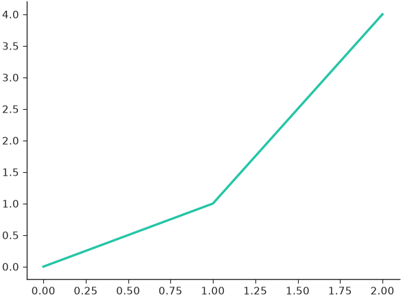
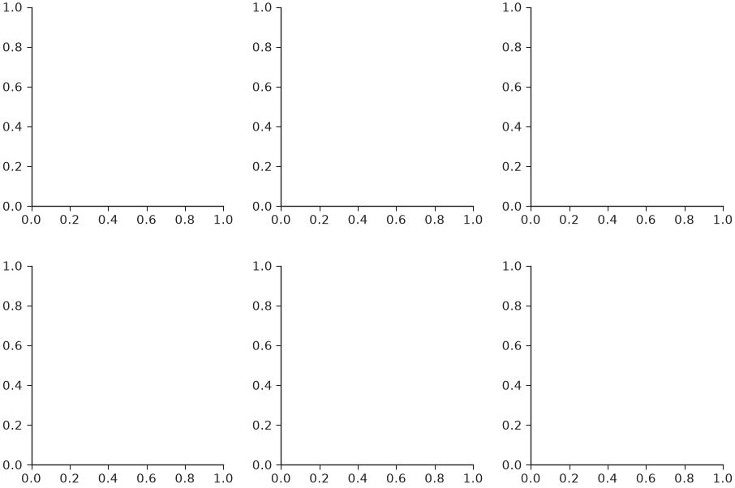
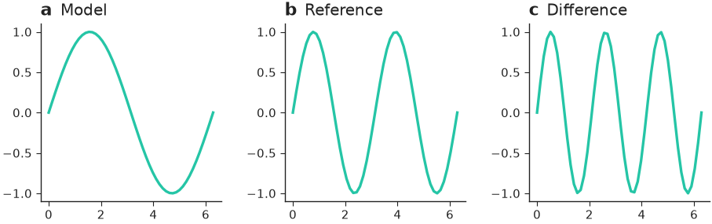
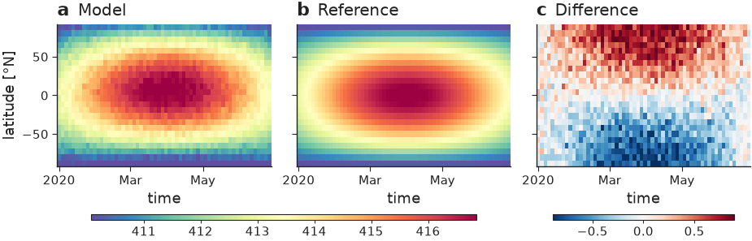
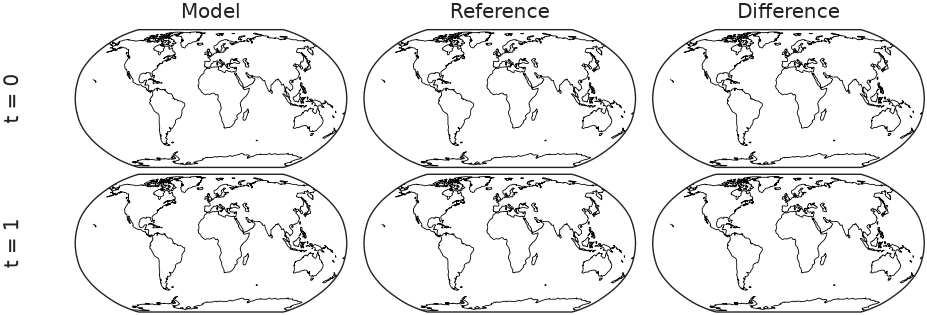
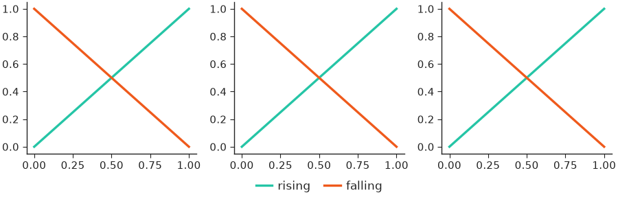
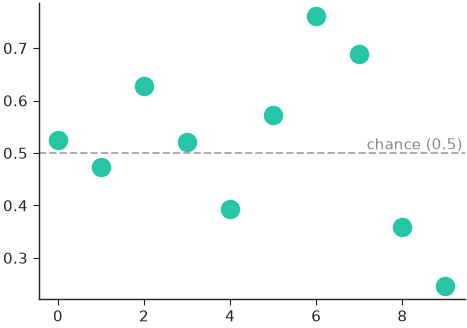
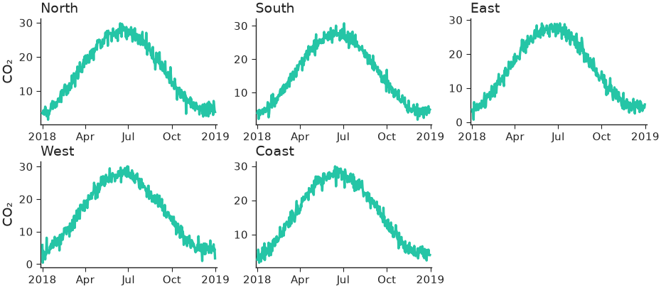
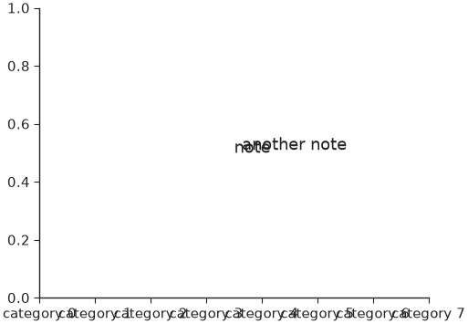

# Figures & sizing

nicefigs creates figures at a physical size: give one dimension, usually a
named width, and an aspect ratio, and the other dimension is solved. Fonts are
in points (see [Styling](styling.md)), so they render at exactly the theme's
sizes in every panel of every figure.

## Creating a figure at a physical size

[`subplots()`][nicefigs.subplots] is `plt.subplots` at a physical size. Name a
width and an aspect (`height / width`):

```python
import nicefigs as nf

nf.set_theme("paper")

fig, ax = nf.subplots(width="single", aspect=0.75)
ax.plot([0, 1, 2], [0, 1, 4])
print(fig.get_size_inches().round(3))
```

```text
[3.504 2.628]
```



The figure is 89 mm wide, one column of a two-column journal. For a grid of
panels, `panel_aspect` shapes each panel instead of the whole figure, and
`wspace`/`hspace` go straight to the gridspec:

```python
import nicefigs as nf

nf.set_theme("paper")

fig, axes = nf.subplots(2, 3, width="full", panel_aspect=1.0, wspace=0.3, hspace=0.3)
print(axes.shape, fig.get_size_inches().round(2))
```

```text
(2, 3) [5.5  3.67]
```



[`figure()`][nicefigs.figure] creates a bare `Figure` the same way. Both take a
`theme` keyword applied while the figure is created, independent of the global
theme.

## Width presets

[`figure_size()`][nicefigs.figure_size] solves `(width, height)` in inches from
a name or explicit inches. It underlies every helper that creates its own
figure (`map`, `image_grid`, `model_comparison`, …):

```python
import nicefigs as nf

for spec in (dict(width="single", aspect=0.75), dict(width=95 / 25.4, aspect=0.5), dict(width="slide-16-9")):
    print([round(v, 2) for v in nf.figure_size(**spec)])
```

```text
[3.5, 2.63]
[3.74, 1.87]
[13.33, 7.5]
```

The named widths in [`WIDTHS`][nicefigs.figure.WIDTHS] are:

| Name | Inches | Typical target |
|---|---|---|
| `"single"` | 3.50 | One column of a two-column journal (Nature 89 mm; AGU 95 mm; ICML 3.25 in) |
| `"onehalf"` | 4.72 | 1.5 columns (Nature 120 mm) |
| `"double"` | 7.20 | Both columns (Nature 183 mm; AGU 190 mm; ICML 6.75 in) |
| `"full"` | 5.50 | Text width of a one-column article (NeurIPS) |
| `"half"` | 2.75 | Half of `"full"` |
| `"third"` | 1.83 | A third of `"full"` |
| `"slide"` / `"slide-half"` / `"slide-third"` | 13.33 / 6.5 / 4.2 | 16:9 slide fractions |

For a venue whose width differs, pass inches, as with `95 / 25.4` above. The
canvases in [`CANVASES`][nicefigs.figure.CANVASES] fix both dimensions:
`"slide-16-9"`, `"slide-4-3"`, `"a4-portrait"`, `"a4-landscape"`,
`"poster-a0-portrait"` and `"poster-a0-landscape"`.

## Labelling panels

[`label_panels()`][nicefigs.label_panels] puts a bold lowercase `a`, `b`, `c`,
… above the top-left corner of each panel, optionally followed by a short
title. The letter has no parentheses, is 1.2 times the axis-label size, starts
flush with the panel's left edge, and sits half its own height above the top
edge; the title follows on the same baseline in normal weight, slightly
smaller:

```python
import numpy as np

import nicefigs as nf

nf.set_theme("paper")

fig, axes = nf.subplots(1, 3, width="full", panel_aspect=0.8, wspace=0.35)
x = np.linspace(0, 2 * np.pi, 50)
for ax, k in zip(axes, (1, 2, 3)):
    ax.plot(x, np.sin(k * x))
nf.label_panels(axes, titles=["Model", "Reference", "Difference"])
```



On cartopy map axes the label anchors to the panel's grid position, so labels
line up down the left margin instead of hugging a narrow map.

If a panel already carries an `ax.set_title()`, for example from
[`hovmoller_panels()`][nicefigs.hovmoller_panels], pass `use_ax_title=True` to
move that title next to the letter, at one height:

```python
import nicefigs as nf
from nicefigs import data

nf.set_theme("paper")

h = data.hovmoller_field(n_time=60, n_lat=24)
fields = {"Model": h["value"], "Reference": h["reference"], "Difference": h["value"] - h["reference"]}
fig, axes = nf.hovmoller_panels(fields, h["times"], h["lats"], diff_fields={"Difference"})
nf.label_panels(axes, use_ax_title=True)
```



!!! note
    A title that already starts with its panel's letter, such as `"a Model"`
    for label `"a"`, loses that leading copy (`dedupe=True`). Pass
    `dedupe=False` to draw both as given.

[`panel_label()`][nicefigs.panel_label] labels a single axes,
[`clean_title()`][nicefigs.clean_title] draws a left-aligned title at the
theme's title size, and [`despine()`][nicefigs.despine] hides chosen spines.

## Grids with row and column labels

[`grid()`][nicefigs.grid] is a `GridSpec`-backed panel grid at a physical size.
It returns a `(nrows, ncols)` array of axes and takes `width_ratios`,
`height_ratios` and one `projection` for every panel.
[`row_labels()`][nicefigs.row_labels] and [`col_labels()`][nicefigs.col_labels]
add rotated row headers down the left margin and column headers above the top
row:

```python
import cartopy.crs as ccrs

import nicefigs as nf

nf.set_theme("paper")

fig, axes = nf.grid(2, 3, width="full", panel_aspect=0.5, projection=ccrs.Robinson(), wspace=0.05, hspace=0.05)
for ax in axes.flat:
    ax.set_global()
    ax.coastlines(linewidth=0.3)
nf.row_labels(axes, ["t = 0", "t = 1"])
nf.col_labels(axes, ["Model", "Reference", "Difference"])
```



`with_legend_row=True` adds a short bottom row for one legend that spans the
figure, and returns its axes as a third value:

```python
import matplotlib.lines as mlines

import nicefigs as nf

nf.set_theme("paper")

fig, axes, ax_legend = nf.grid(1, 3, width="full", panel_aspect=1.0, with_legend_row=True)
for ax in axes.flat:
    ax.plot([0, 1], [0, 1], color="C0")
    ax.plot([0, 1], [1, 0], color="C1")
handles = [mlines.Line2D([], [], color=c, label=n) for c, n in [("C0", "rising"), ("C1", "falling")]]
ax_legend.legend(handles=handles, loc="center", ncol=2, frameon=False)
```



## Reference lines

[`reference_line()`][nicefigs.reference_line] draws a horizontal (`axis="y"`,
the default) or vertical line with an optional inline label; `fmt` can use
`{label}` and `{value}`:

```python
import numpy as np

import nicefigs as nf

nf.set_theme("paper")

fig, ax = nf.subplots(width="half", aspect=0.7)
ax.plot(np.arange(10), np.random.default_rng(0).normal(0.5, 0.2, 10), "o")
nf.reference_line(ax, 0.5, label="chance", fmt="{label} ({value:.2g})")
```



The baselines of [`pareto()`][nicefigs.pareto] and the `ref_line` of
[`caterpillar()`][nicefigs.caterpillar] are drawn with this helper.

## Small multiples

[`facet()`][nicefigs.facet] lays out one panel per item and calls
`draw(ax, item, i)` for each. The grid shape follows from `len(items)` and
`ncols`; unused cells are hidden:

```python
import nicefigs as nf
from nicefigs import data

nf.set_theme("paper")

stations = ["North", "South", "East", "West", "Coast"]


def draw(ax, station, i):
    dates, series = data.timeseries(n_days=365, seed=i, series=["model"])
    nf.timeseries(dates, series, ax=ax, ylabel="CO₂" if i % 3 == 0 else "", legend=False)


fig, axes = nf.facet(stations, draw, ncols=3, panel_aspect=0.62, titles=stations)
```



The sixth cell is hidden. See the
[station time-series example](../gallery.md#station-timeseries) for a version
with observations and a shared legend.

## Saving

[`save()`][nicefigs.save] writes one tight (`bbox_inches="tight"`) file per
format at the theme's `savedpi` (300 by default), creating parent directories.
It returns the written paths:

```python
import matplotlib.pyplot as plt

import nicefigs as nf

nf.set_theme("paper")

fig, ax = nf.subplots(width="half")
paths = nf.save(fig, "figures/line", formats=("pdf", "png"), close=True)
print([str(p) for p in paths], plt.get_fignums())
```

```text
['figures/line.pdf', 'figures/line.png'] []
```

`close=True` closes the figure after saving; `transparent=True` drops the
background.

## Checking text layout

[`check_text_overlaps()`][nicefigs.check_text_overlaps] draws the figure once
and reports every pair of text artists whose rendered boxes intersect, and
every text that leaves the canvas:

```python
import nicefigs as nf

nf.set_theme("paper")

fig, ax = nf.subplots(width="half", aspect=0.75)
ax.set_xticks(range(8), [f"category {i}" for i in range(8)])
ax.text(0.5, 0.5, "note", transform=ax.transAxes)
ax.text(0.52, 0.51, "another note", transform=ax.transAxes)
for issue in nf.check_text_overlaps(fig, ignore_ticks=True):
    print(issue)
print(len(nf.check_text_overlaps(fig)))
```

```text
TextIssue(kind='overlap', texts=('note', 'another note'))
8
```



With tick labels counted, the crowded category axis adds seven overlapping
pairs. Boxes are axis-aligned, so labels rotated by 45° overlap their
neighbours' boxes even when the glyphs do not; rotate by 90° or pass
`ignore_ticks=True`. Tick labels outside the axis limits are never drawn and
never counted.

!!! note
    A box crossing the figure edge is reported as `"clipped"` although
    [`save()`][nicefigs.save] grows the canvas to keep it; pass
    `clipped=False` when only overlaps matter.
