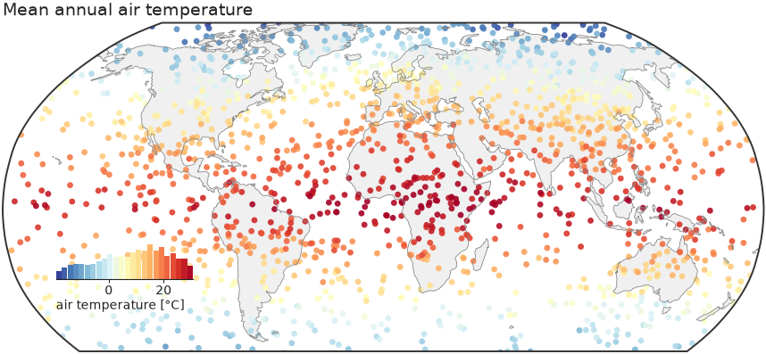
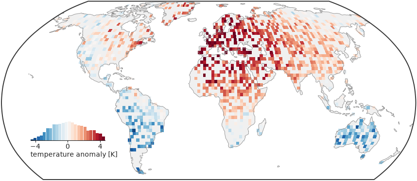
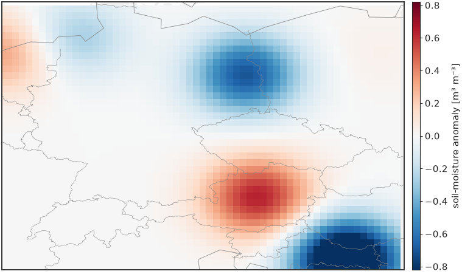
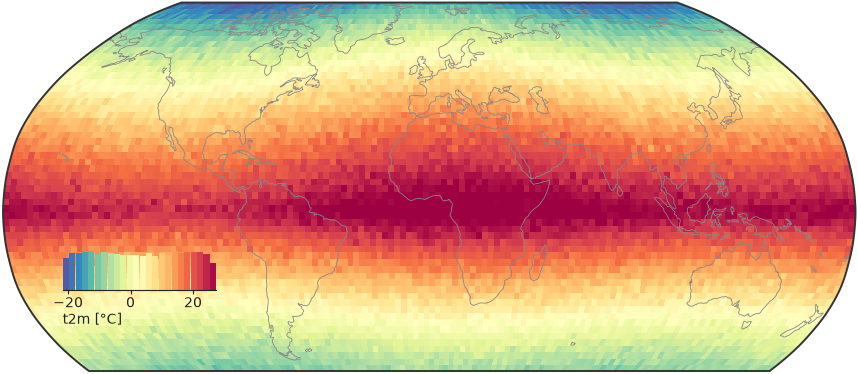
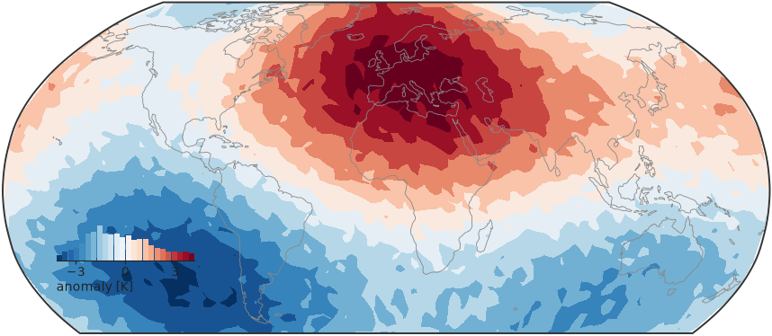
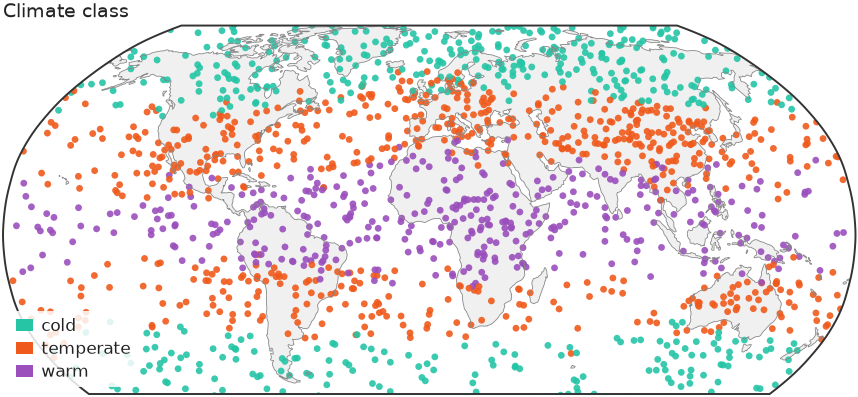
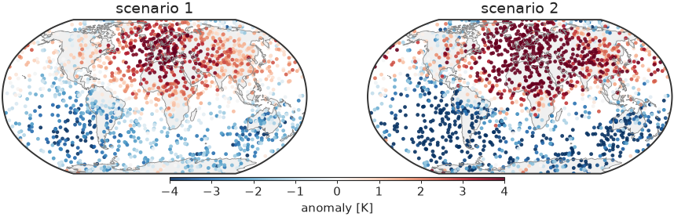
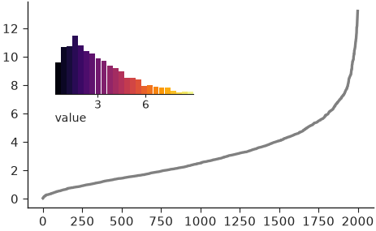
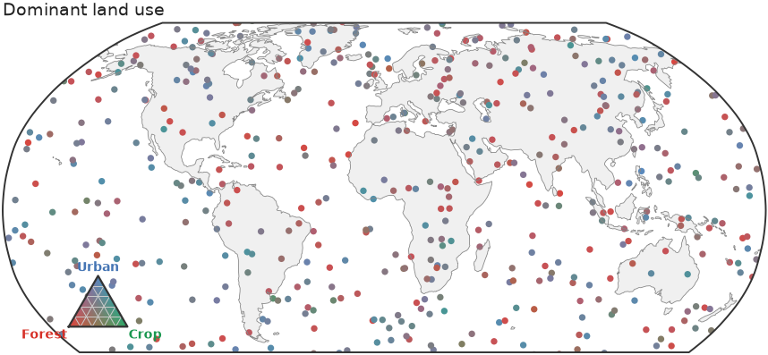

# Maps

[`map()`][nicefigs.map] draws values at longitude/latitude on a
Robinson-projected world map with Antarctica cropped, a light land backdrop,
coastlines and an inset histogram that doubles as the colorbar. It returns
`(fig, ax, mappable)`. With `cartopy` installed (`pip install "nicefigs[maps]"`)
the map is projected; without it, every map helper falls back to a plain
equirectangular axes. The examples set the house style with
`nf.set_theme("paper")`; see [Styling & themes](styling.md).

## Mapping scattered points

Pass 1-D `lon`, `lat` and `values`; below 5000 points `map` scatters them:

```python
import nicefigs as nf
from nicefigs import data

nf.set_theme("paper")

lon, lat, temp = data.global_points(field="temperature")
fig, ax, mappable = nf.map(
    lon, lat, temp,
    cmap="RdYlBu_r",
    colorbar_label="air temperature [°C]",
    title="Mean annual air temperature",
)
print(type(mappable).__name__, len(temp))
```

```text
PathCollection 1729
```



Colour limits come from the 2nd and 98th percentiles (`robust=True`), so a few
extreme stations do not wash out the scale.

## Bin-averaging dense data

`kind` picks `"scatter"`, `"binned"` or `"auto"` (binned above 5000 points).
`kind="binned"` averages onto a `bin_deg` grid; `diverging=True` picks a
diverging colormap with limits symmetric about `center` (default 0), the right
choice for anomalies:

```python
import nicefigs as nf
from nicefigs import data

nf.set_theme("paper")

lon, lat, anom = data.global_points(n=9000, field="anomaly")
fig, ax, mappable = nf.map(
    lon, lat, anom,
    kind="binned", diverging=True, bin_deg=2.5,
    colorbar_label="temperature anomaly [K]",
)
vmin, vmax = mappable.get_clim()
print(f"{vmin:.2f} {vmax:.2f}")
```

```text
-4.59 4.59
```



The limits are symmetric, so zero sits on the colormap's neutral centre. A
global binned map drops bins whose centre is at sea; pass `clip_ocean=False`
for data measured over the ocean.

## Choosing a projection and extent

`projection` is one of `"robinson"` (default), `"platecarree"`,
`"mollweide"`, `"equalearth"`, `"orthographic"` or `"nearside"`, resolved by
[`make_map_axes()`][nicefigs.make_map_axes]; an unknown name raises
`ValueError`. `extent=(west, east, south, north)` zooms to a region and
replaces the default Antarctica crop
([`ANTARCTICA_CUTOFF_EXTENT`][nicefigs.maps.ANTARCTICA_CUTOFF_EXTENT]):

```python
import nicefigs as nf
from nicefigs import data

nf.set_theme("paper")

lon, lat, field = data.regional_grid(res=0.25)
fig, ax, mappable = nf.map(
    lon, lat, field,
    extent=(5, 20, 45, 55),
    projection="platecarree",
    diverging=True, inset_hist=False, cbar=True, borders=True,
    colorbar_label="soil-moisture anomaly [m³ m⁻³]",
)
print(field.shape)
```

```text
(40, 60)
```



A 2-D `field` is drawn as a raster; a regional map usually wants a slim
colorbar (`cbar=True`) rather than the inset histogram.

## Mapping gridded and unstructured data

`map` dispatches on its input. A 2-D `values` array on a regular grid goes to
[`raster_map()`][nicefigs.raster_map] (`pcolormesh`); a `DataArray` with
recognisable longitude/latitude coordinates is unpacked by
[`from_xarray()`][nicefigs.from_xarray] first:

```python
import nicefigs as nf
from nicefigs import data

nf.set_theme("paper")

da = data.global_dataarray()
lon, lat, field = nf.from_xarray(da)
fig, ax, mappable = nf.map(da, cmap="Spectral_r", colorbar_label="t2m [°C]")
print(da.dims, field.shape)
```

```text
('lat', 'lon') (72, 144)
```



For points on an unstructured or icosahedral mesh, `kind="tri"` triangulates
them in projected coordinates and draws them with
[`tri_map()`][nicefigs.tri_map] (`tricontourf`, or `"tripcolor"`). Triangles
that would span the antimeridian or wrap over a pole are masked:

```python
import nicefigs as nf
from nicefigs import data

nf.set_theme("paper")

lon, lat, values = data.icosahedral_field(n=3000)
fig, ax, mappable = nf.map(lon, lat, values, kind="tri", diverging=True,
                           colorbar_label="anomaly [K]")
```



## Mapping class labels

[`categorical_map()`][nicefigs.categorical_map] draws a class label per point
— a land-cover code, a cluster id, a mask — in discrete colours with a patch
legend instead of a colorbar. Through `map`, pass `kind="categorical"` and the
ordered `categories`:

```python
import numpy as np

import nicefigs as nf
from nicefigs import data

nf.set_theme("paper")

lon, lat, temp = data.global_points(field="temperature")
codes = np.digitize(temp, [5.0, 20.0])  # 0 cold, 1 temperate, 2 warm
fig, ax, mappable = nf.map(
    lon, lat, codes, kind="categorical",
    categories=["cold", "temperate", "warm"],
    title="Climate class",
)
print([t.get_text() for t in ax.get_legend().get_texts()])
```

```text
['cold', 'temperate', 'warm']
```



A sequence of names reads `codes` as `0..n-1`; a `{code: name}` mapping takes
arbitrary codes. Colours default to [`qualitative()`][nicefigs.qualitative]
and can be set with `colors`. Codes outside `categories` and non-finite
coordinates are dropped. Above 5000 points the cloud is gridded by **majority
vote** per cell, since the mean of class codes is meaningless; ties go to the
category listed first.

!!! note
    Class codes carry their own discrete norm, so `vmin`, `vmax`, `robust` and
    `diverging` are ignored for `kind="categorical"`, and no colorbar or inset
    histogram is drawn.

## Composing map panels

The layer helpers — [`scatter_map()`][nicefigs.scatter_map],
[`binned_map()`][nicefigs.binned_map], `raster_map`, `tri_map` and
`categorical_map` — draw onto a map axes you pass as `ax` and return
`(ax, mappable)`; the cartopy CRS is detected from the axes. Build the axes
with [`make_map_axes()`][nicefigs.make_map_axes], add land and coastlines with
[`draw_background()`][nicefigs.draw_background], and share one colorbar across
panels with [`colorbar()`][nicefigs.colorbar]:

```python
import nicefigs as nf
from nicefigs import data

nf.set_theme("paper")
fig = nf.figure(width="full", aspect=0.32)
lon, lat, anom = data.global_points(field="anomaly")
for i in range(2):
    ax, ccrs = nf.make_map_axes(fig, (1, 2, i + 1))
    nf.draw_background(ax, ccrs)
    _, mappable = nf.scatter_map(lon, lat, anom * (i + 1), ax=ax, cmap="RdBu_r",
                                 vmin=-4, vmax=4, size=3)
    ax.set_title(f"scenario {i + 1}")
nf.colorbar(mappable, fig.axes, label="anomaly [K]", location="bottom", shrink=0.5)
```



Both panels share fixed limits, so one colorbar reads for both.

## Docking the histogram colorbar

[`inset_histogram_colorbar()`][nicefigs.inset_histogram_colorbar] is the
histogram `map` docks in the empty South Pacific: a histogram of the mapped
values coloured by the same colormap, so it shows both the colour scale and
the data distribution. Call it on any axes; `bounds` places it in axes
fractions:

```python
import numpy as np

import nicefigs as nf

nf.set_theme("paper")

values = np.random.default_rng(0).gamma(2.0, 1.5, 2000)
fig, ax = nf.subplots(width="half", aspect=0.6)
ax.plot(np.sort(values), color="0.5")
nf.inset_histogram_colorbar(ax, values, cmap="inferno", bounds=(0.08, 0.55, 0.4, 0.3),
                            label="value")
```



## Ternary maps

For a three-part composition per point, such as land-use fractions,
[`ternary_map()`][nicefigs.ternary_map] colours each point by a barycentric
blend of three corner colours and adds a triangular legend:

```python
import nicefigs as nf
from nicefigs import data

nf.set_theme("paper")

lon, lat, _ = data.global_points(n=600, land_bias=False)
comp, _ = data.ternary_points(n=600)
fig, ax = nf.ternary_map(lon, lat, comp, labels=("Forest", "Crop", "Urban"),
                         size=7, title="Dominant land use")
print(comp.shape, comp.sum(axis=1).min().round(6))
```

```text
(600, 3) 1.0
```



See [Colormaps & palettes](colormaps.md#ternary-3-component-colour-encoding)
for the corner palettes shared by every ternary helper.
