# Plots

This page covers the plotting helpers beyond maps: images, scatter and
agreement plots, time series, model comparisons, rankings, scorecards,
vertical sections and Hovmöller diagrams. Every helper takes `ax=None` and
creates a figure when it is missing; see the
[calling conventions](../quickstart.md#calling-conventions) for what each
returns.

## Showing images and heatmaps

[`image()`][nicefigs.image] shows an intensity array coloured by `cmap`, or an
`(H, W, 3|4)` colour image, without ticks. `stretch=True` contrast-stretches a
colour image per channel. [`heatmap()`][nicefigs.heatmap] adds row and column
labels and, with `annotate=True`, the value of each cell.

```python
import nicefigs as nf
from nicefigs import data

nf.set_theme("paper")
fig, (ax_img, ax_hm) = nf.subplots(1, 2, width="full", panel_aspect=0.8, wspace=0.3)
nf.image(data.rgb_patch(), stretch=True, title="RGB patch", ax=ax_img)
nf.heatmap(
    data.heatmap_matrix(shape=(5, 6)),
    row_labels=list("ABCDE"),
    col_labels=[f"c{j}" for j in range(6)],
    annotate=True,
    ax=ax_hm,
)
```

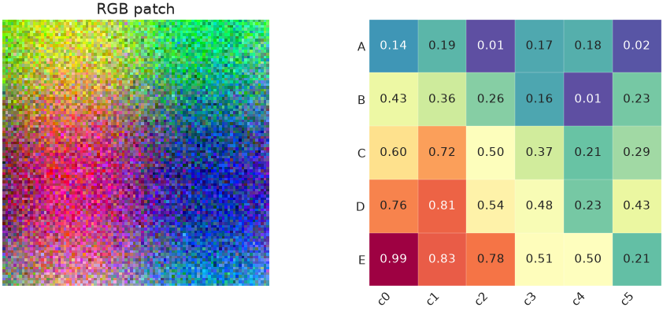

A three-channel array is drawn as colour; a two-dimensional array is drawn
with `cmap`.

[`image_grid()`][nicefigs.image_grid] lays out several images with one shared
colour scale and colorbar. `colorbar_mode` is `"single"` (default), `"row"`,
`"each"` or `"none"`; `shared_scale=False` gives each image its own limits.

```python
import nicefigs as nf
from nicefigs import data

nf.set_theme("paper")
images = [data.regional_grid(seed=i)[2] for i in range(6)]
fig, axes = nf.image_grid(
    images,
    nrows=2,
    ncols=3,
    width="full",
    cmap="Spectral_r",
    colorbar_label="value",
    titles=[f"member {i + 1}" for i in range(6)],
)
nf.label_panels(axes)
```

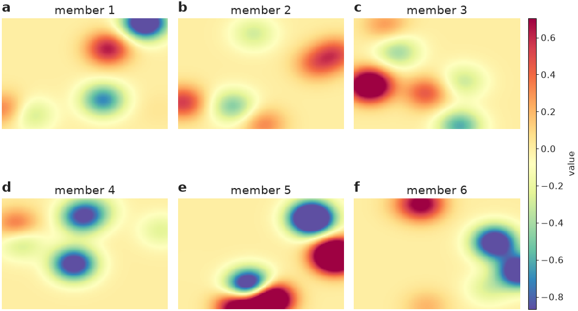

All six panels share one colorbar, so equal colours mean equal values.

For land-cover rasters, pass a [`Categorical`][nicefigs.Categorical] palette's
`.to_rgb()` to `image()`; see
[Colormaps & palettes](colormaps.md#categorical-land-cover-palettes).

## Scatter plots with encodings

[`scatter()`][nicefigs.scatter] maps extra variables onto marker shape (a
categorical `group`), size (`size`, scaled into `size_range`) and colour (a
continuous `hue`, or `group`), and builds a legend for each.

```python
import nicefigs as nf
from nicefigs import data

nf.set_theme("paper")
d = data.scatter_bubbles(n=140)
ax, artists = nf.scatter(
    d["x"], d["y"], group=d["group"], size=d["size"], size_label="area [km²]", alpha=0.8
)
nf.set_labels(ax, "predictor", "response")
print(sorted(artists))
```

```text
['A', 'B', 'C']
```

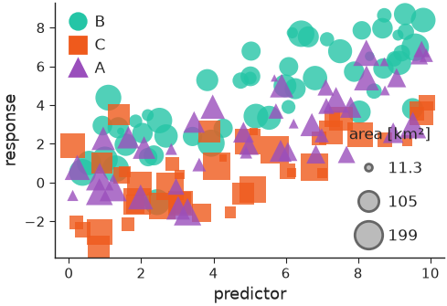

With `group`, the second return value maps each group to its collection.
`hue=values, colorbar=True` colours by a continuous variable instead;
`xerr`/`yerr` add error bars and `point_labels` with `label_top=n` labels the
`n` most extreme points.

## Agreement plots

[`agreement()`][nicefigs.agreement] compares predictions with observations:
a density of the point cloud (`density="kde"`, `"hexbin"` or `"hist"`), a
dashed 1:1 line, outliers as faint points, a regression line and a metrics
box. It returns the metrics as a dict.

```python
import nicefigs as nf
from nicefigs import data

nf.set_theme("paper")
obs, pred = data.xy_agreement()
ax, stats = nf.agreement(
    obs, pred, xlabel="observed runoff", ylabel="predicted runoff", units="mm d⁻¹", width="half"
)
print({k: round(float(v), 3) for k, v in stats.items()})
```

```text
{'slope': 0.906, 'intercept': 1.001, 'r2': 0.721, 'rmse': 1.846, 'bias': 0.533, 'n': 1500.0}
```

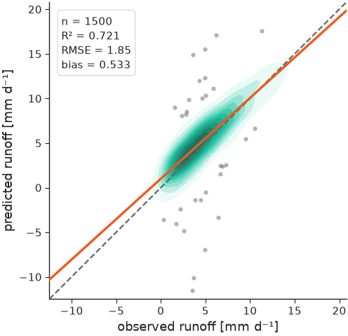

The printed metrics are the ones in the box on the plot.

## Time series

[`timeseries()`][nicefigs.timeseries] plots named series against dates and
picks date ticks for the span. `bands` shades an interval per series and
`highlight` draws one series thicker and on top.

```python
import nicefigs as nf
from nicefigs import data

nf.set_theme("paper")
dates, series = data.timeseries(n_days=365)
model = series["model A"]
ax = nf.timeseries(
    dates,
    series,
    bands={"model A": (model - 2.0, model + 2.0)},
    highlight="observed",
    ylabel="air temperature",
    yunits="degC",
    width="full",
)
```

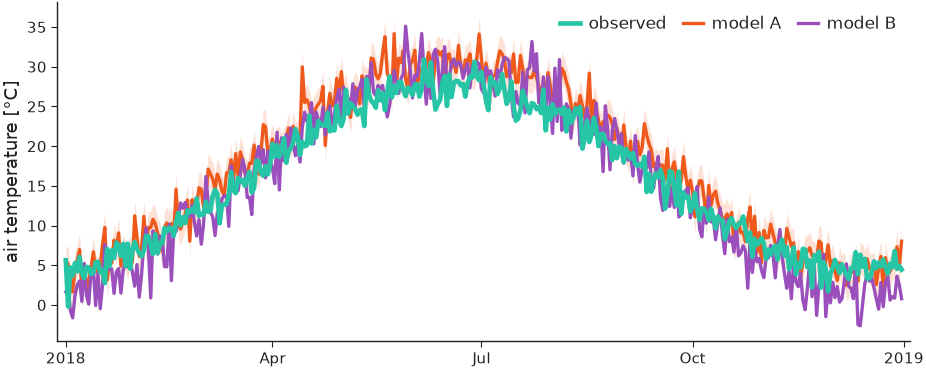

The observed series sits on top of the two models; model A carries its band.

Sparse observations go in `obs=(dates, values)` and are drawn as markers.
`obs_hue` colours them by a third variable, with `obs_colorbar=True` for its
colorbar:

```python
import numpy as np

import nicefigs as nf
from nicefigs import data

nf.set_theme("paper")
dates, series = data.timeseries(n_days=200, series=["model"])
rng = np.random.default_rng(0)
idx = np.sort(rng.choice(len(dates), 60, replace=False))
obs_dates = [dates[i] for i in idx]
obs_vals = series["model"][idx] + rng.normal(0, 1, 60)
ax = nf.timeseries(
    dates,
    series,
    obs=(obs_dates, obs_vals),
    obs_hue=rng.uniform(0, 12000, 60),
    obs_cmap="viridis",
    obs_hue_label="altitude [m]",
    obs_colorbar=True,
    ylabel="CO2",
    yunits="ppm",
    width="full",
)
```

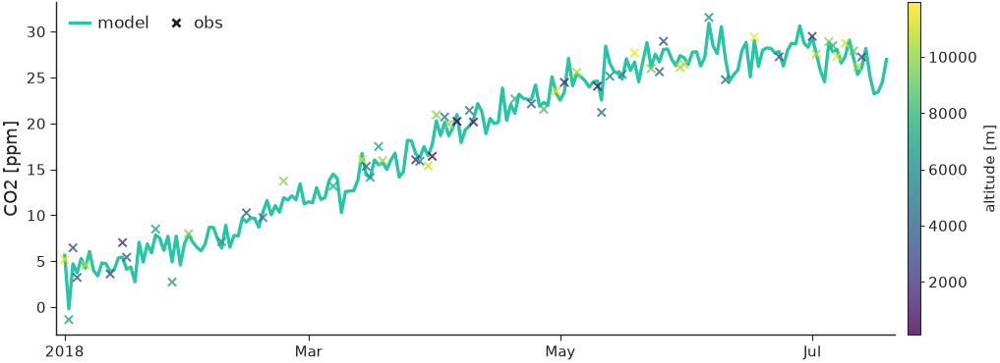

`styles` sets per-series line styles and `annotation` writes a short note in
the panel, which suits small multiples built with
[`facet()`][nicefigs.facet] (see [Figures & sizing](figures.md#small-multiples-with-facet)).

## Comparing models

[`model_comparison()`][nicefigs.model_comparison] takes
`{metric: {model: values}}`, or `{metric: {model: {group: values}}}` for a
second split such as timescale, and draws one panel per metric with a violin
(`kind="violin"`), box (`"box"`) or strip (`"strip"`) per model.

```python
import nicefigs as nf
from nicefigs import data

nf.set_theme("paper")
scores = data.model_scores()["scores"]
fig, axes = nf.model_comparison(
    scores, group_label="timescale", kind="box", metric_units={"RMSE": "mm"}
)
print(len(axes))
```

```text
3
```

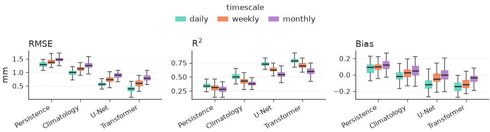

One panel per metric, with the groups dodged inside each model and one shared
legend.

[`taylor()`][nicefigs.taylor] summarises the same question in one diagram:
each model sits at its correlation (angle) and standard deviation (radius),
with centred-RMS arcs around the reference. Give each model a `correlation`
and either `std` or `std_ratio`.

```python
import nicefigs as nf

nf.set_theme("paper")
ax = nf.taylor(
    [
        {"name": "model A", "correlation": 0.93, "std_ratio": 0.98},
        {"name": "model B", "correlation": 0.80, "std_ratio": 1.15},
        {"name": "model C", "correlation": 0.65, "std_ratio": 0.70},
    ],
    width="half",
)
```

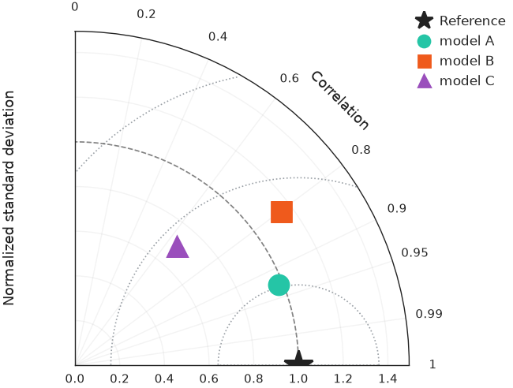

Model A lies closest to the reference star, so it has the smallest centred
RMS error.

## Ranking and trade-offs

[`pareto()`][nicefigs.pareto] scatters a trade-off and draws the
non-dominated [`frontier()`][nicefigs.frontier] on top, one per group with
`frontier_per_group=True`. `xdirection` and `ydirection` say which way is
better; they define the frontier and add arrows to the axis labels.

```python
import nicefigs as nf
from nicefigs import data

nf.set_theme("paper")
d = data.pareto_tradeoff()
ax, _ = nf.pareto(
    d["x"],
    d["y"],
    group=d["group"],
    frontier_per_group=True,
    xdirection="higher_better",
    ydirection="higher_better",
    xlabel="speed",
    ylabel="skill",
)
front = nf.frontier(d["x"], d["y"], xdirection="higher_better", ydirection="higher_better")
print(len(front), "of", len(d["x"]), "points are Pareto-optimal")
```

```text
14 of 36 points are Pareto-optimal
```

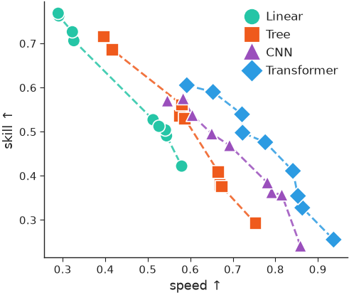

Each group traces its own frontier: no point on it can gain speed without
losing skill. `baselines={label: y}` adds labelled horizontal reference lines.

[`caterpillar()`][nicefigs.caterpillar] ranks per-item values with error bars,
optionally with a `baseline` series offset next to each item and a `summary`
annotation.

```python
import nicefigs as nf
from nicefigs import data

nf.set_theme("paper")
s = data.site_metrics(n_sites=16)
ax = nf.caterpillar(
    s["labels"],
    s["bias"],
    err=s["std"],
    groups=s["layer"],
    baseline=s["baseline"],
    baseline_label="reference model",
    value_label="bias",
    value_units="ppmv",
    ref_line=0.0,
)
```

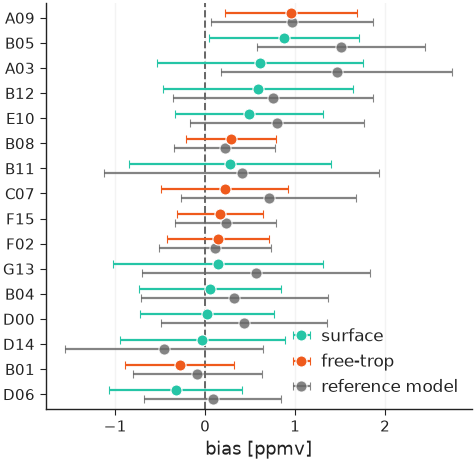

Items are sorted by value, coloured by group, with the reference model's
value offset beside each.

## Scorecards

[`scorecard()`][nicefigs.scorecard] renders a model × metric table as
coloured cells. By default each column is ranked on its own, using each
metric's `direction` from [`DIRECTIONS`][nicefigs.DIRECTIONS], and the best
cell per column is outlined.

```python
import numpy as np

import nicefigs as nf
from nicefigs import data

nf.set_theme("paper")
ms = data.model_scores()
values = np.array(
    [[np.mean(ms["scores"][m][model]["daily"]) for m in ms["metrics"]] for model in ms["models"]]
)
ax = nf.scorecard(
    values,
    row_labels=ms["models"],
    col_labels=ms["metrics"],
    direction={"RMSE": "lower_better", "Bias": "target", "R$^2$": "higher_better"},
    col_units={"RMSE": "mm"},
)
```

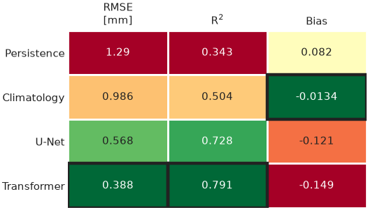

Bias is ranked by closeness to zero, the default `target`.

To colour cells by their value instead, pass a `norm`, for example from
[`scorecard_diverging_cmap()`][nicefigs.scorecard_diverging_cmap].
`col_groups` gaps and titles groups of columns, `square=True` forces square
cells and `colorbar=True` adds a colorbar.

```python
import numpy as np

import nicefigs as nf

nf.set_theme("paper")
rng = np.random.default_rng(1)
pct_diff = np.vstack([np.zeros(4), rng.normal(-8, 6, (2, 4))])
cmap, norm = nf.scorecard_diverging_cmap()
ax = nf.scorecard(
    pct_diff,
    row_labels=["baseline", "model A", "model B"],
    col_labels=["Z500", "T850", "T2m", "MSL"],
    cmap=cmap,
    norm=norm,
    direction=dict.fromkeys(["Z500", "T850", "T2m", "MSL"], "lower_better"),
    col_groups=["upper air", "upper air", "surface", "surface"],
    square=True,
    cell_format="{:+.0f}",
    colorbar=True,
    colorbar_label="RMSE difference [%]",
)
```

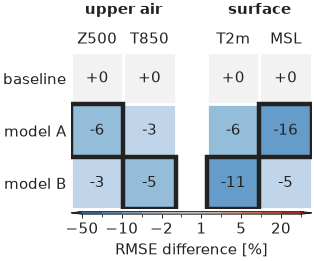

Negative differences, an improvement over the baseline, are blue; the outline
marks the lowest value per column.

[`skill_gap()`][nicefigs.skill_gap] computes the signed distance of each value
from a reference, positive where the value is better. Passing `reference=` to
`scorecard` colours cells by this gap, so metrics in different units share one
scale.

```python
import nicefigs as nf

gap = nf.skill_gap([[0.8, 1.2]], [[1.0, 1.0]], direction=["higher_better", "lower_better"])
print(gap)
```

```text
[[-0.2 -0.2]]
```

Both values are 0.2 worse than the reference, whichever way their metric is
read.

## Bar charts

[`grouped_bars()`][nicefigs.grouped_bars] dodges one bar per
`(category, series)`; [`stacked_bars()`][nicefigs.stacked_bars] stacks the
series within each category, as fractions with `normalize=True`.

```python
import nicefigs as nf

nf.set_theme("paper")
regions = ["Amazon", "Congo", "Boreal", "Sahel"]
fig, (ax_g, ax_s) = nf.subplots(1, 2, width="full", panel_aspect=0.8, wspace=0.35)
nf.grouped_bars(
    regions,
    {"model A": [0.72, 0.65, 0.80, 0.55], "model B": [0.81, 0.74, 0.85, 0.63]},
    value_label="skill",
    rotation=30,
    ax=ax_g,
)
nf.stacked_bars(
    regions,
    {"forest": [0.7, 0.6, 0.5, 0.1], "grass": [0.2, 0.25, 0.2, 0.5], "bare": [0.1, 0.15, 0.3, 0.4]},
    normalize=True,
    rotation=30,
    ax=ax_s,
)
```

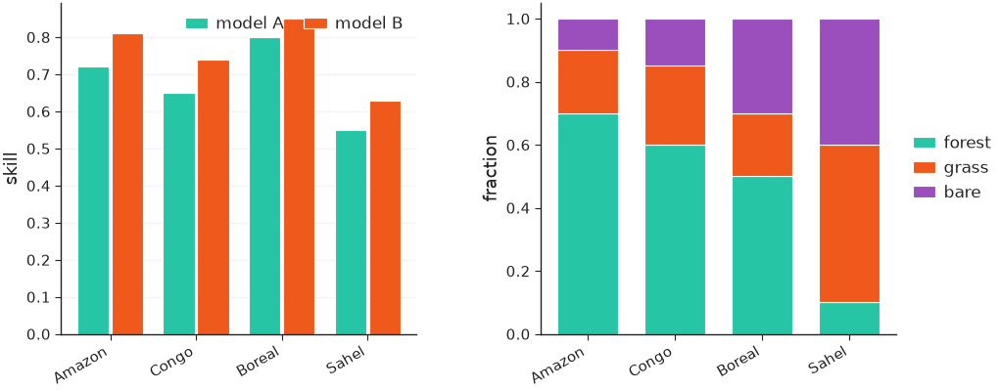

## Vertical sections and profiles

[`cross_section()`][nicefigs.cross_section] draws a field over a horizontal
and a vertical coordinate, such as latitude × pressure.
[`cross_section_panels()`][nicefigs.cross_section_panels] lays out several
with shared colorbars: fields named in `diff_fields` go on a symmetric
diverging scale, and `log_y=True` log-scales the vertical axis.

```python
import nicefigs as nf
from nicefigs import data

nf.set_theme("paper")
cs = data.cross_section_field()
value = cs["value"]
fig, axes = nf.cross_section_panels(
    {"CO₂": value, "anomaly": value - value.mean(axis=0, keepdims=True)},
    cs["lats"],
    cs["levels"],
    diff_fields={"anomaly"},
    value_label="CO₂ [ppm]",
    diff_label="Δ CO₂ [ppm]",
    log_y=True,
)
```

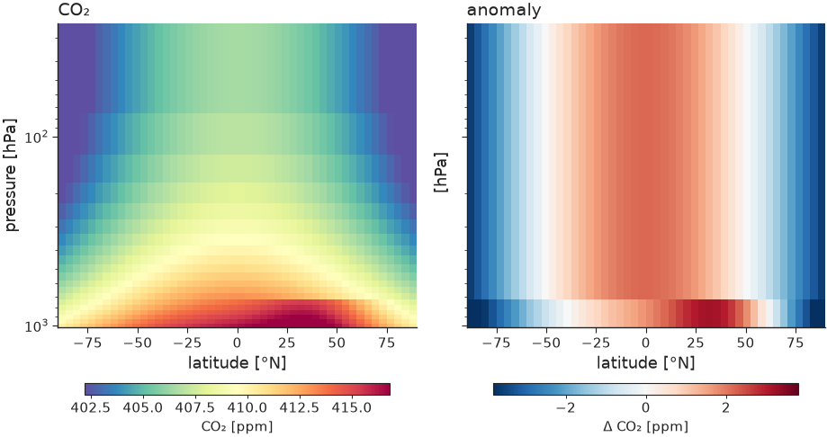

The anomaly panel gets its own diverging colorbar, centred on zero.

[`profile()`][nicefigs.profile] draws value-versus-level profiles with an
inverted vertical axis and dashed `baselines`.

```python
import nicefigs as nf
from nicefigs import data

nf.set_theme("paper")
vp = data.vertical_profiles()
ax = nf.profile(
    vp["profiles"],
    vp["levels"],
    baselines={"reference": vp["baseline"]},
    xlabel="CO₂",
    xunits="ppmv",
    ylabel="pressure",
    yunits="hPa",
    log_y=True,
    width="half",
)
```

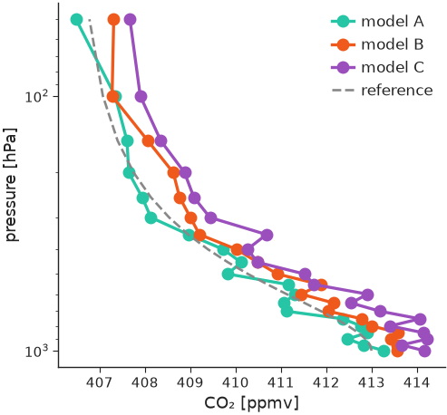

## Hovmöller diagrams

[`hovmoller()`][nicefigs.hovmoller] draws a field over time and one spatial
coordinate; [`hovmoller_panels()`][nicefigs.hovmoller_panels] lays out model,
reference and difference with split colorbars, like `cross_section_panels`.

```python
import nicefigs as nf
from nicefigs import data

nf.set_theme("paper")
h = data.hovmoller_field()
fig, axes = nf.hovmoller_panels(
    {"Model": h["value"], "Reference": h["reference"], "Difference": h["value"] - h["reference"]},
    h["times"],
    h["lats"],
    diff_fields={"Difference"},
    value_label="CO₂ [ppm]",
    diff_label="Δ CO₂ [ppm]",
)
```

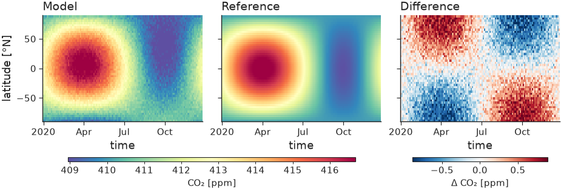

## Composites of many channels

[`pca_rgb()`][nicefigs.pca_rgb] projects an `(H, W, C)` field onto its first
three principal components and returns a stretched `(H, W, 3)` image. With
`return_basis=True` it also returns the projection and its colour limits;
passing that `basis` to later calls keeps several patches on one colour scale.
`image(..., overlay_contour=mask)` outlines a mask on top.

```python
import numpy as np

import nicefigs as nf

nf.set_theme("paper")
rng = np.random.default_rng(0)
cube = rng.normal(size=(64, 64, 8)).cumsum(axis=0).cumsum(axis=1)
rgb, basis = nf.pca_rgb(cube, return_basis=True)
fig, ax = nf.subplots(width="single", aspect=1.0)
nf.image(rgb, overlay_contour=cube[..., 0] > np.median(cube[..., 0]), ax=ax)
print(rgb.shape, float(rgb.min()), float(rgb.max()))
```

```text
(64, 64, 3) 0.0 1.0
```

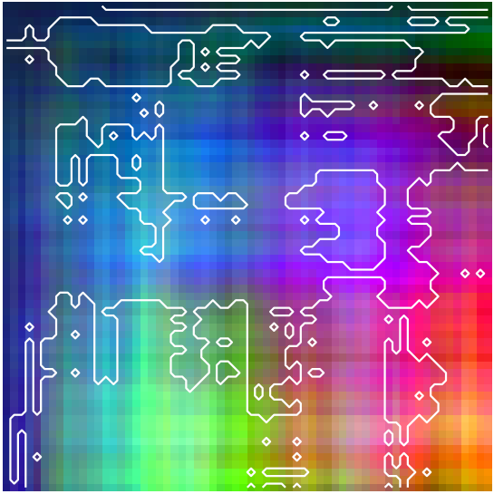

## Plotting eigen-spectra

[`spectrum()`][nicefigs.spectrum] plots covariance eigenvalues `λ_k` against
rank `k` on log–log axes, normalised to `λ_k / Σλ` by default. Pass one 1-D
array, a list, or a `{name: eigenvalues}` dict to overlay several states;
`reference_alpha` adds a `k^-α` power law through the first series' leading
value:

```python
import nicefigs as nf
from nicefigs import data

nf.set_theme("paper")
spectra = data.eigen_spectra()  # {"lead 6 h": λ, "lead 24 h": λ, "lead 72 h": λ}
fig, axes = nf.subplots(1, 2, width="full", aspect=0.42, layout="constrained")
nf.spectrum(spectra, ax=axes[0], reference_alpha=1.0)
nf.spectrum(spectra, ax=axes[1], cumulative=True, legend=False)
```

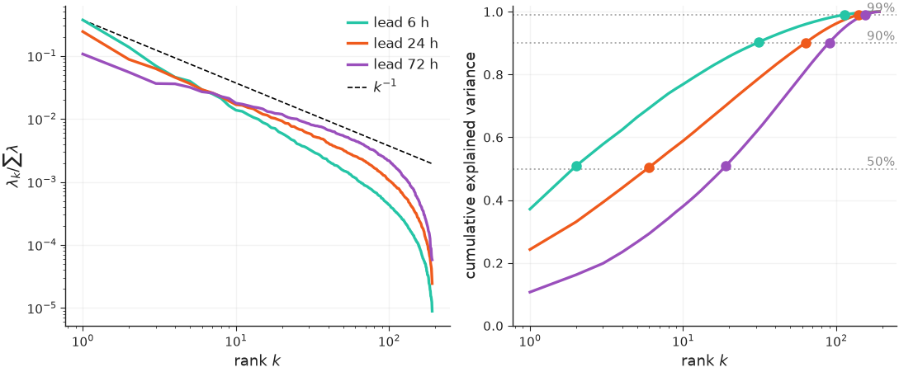

`cumulative=True` (right) plots the cumulative explained-variance fraction on a
log rank axis, with one labelled dotted guide per threshold and a marker where
each series first reaches it. Each spectrum is sorted descending and loses its
non-finite, non-positive and round-off-sized (`λ ≤ rtol · λ_max`) eigenvalues,
so the rank-deficient tail of a sample covariance does not distort the log
axis; set `rtol=0` to keep every positive eigenvalue.

## Labelling axes with units and directions

[`axis_label()`][nicefigs.axis_label] composes `"Quantity [unit]"` labels and
prettifies the unit with [`prettify_unit()`][nicefigs.prettify_unit]; a
`direction` from [`DIRECTIONS`][nicefigs.DIRECTIONS] appends an arrow.
[`metric_label()`][nicefigs.metric_label] looks a metric key up in
[`METRIC_NAMES`][nicefigs.METRIC_NAMES], and with `direction=True` its arrow in
[`METRIC_DIRECTION`][nicefigs.METRIC_DIRECTION].

```python
import nicefigs as nf

print(nf.axis_label("flux", "gC m-2 d-1"))
print(nf.axis_label("skill", direction="higher_better"))
print(nf.metric_label("rmse", "mm", direction=True))
```

```text
flux [gC m⁻² d⁻¹]
skill ↑
RMSE [mm] ↓
```

`"target"` adds no arrow; every helper that asks which way is better
(`scorecard`, `skill_gap`, `lines`, `pareto`) takes the same three strings.
