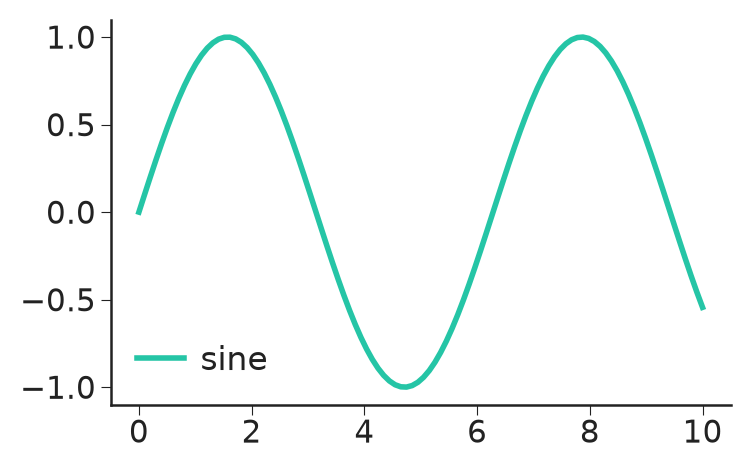
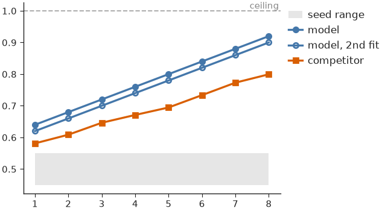

# Styling & themes

A [`Theme`][nicefigs.style.Theme] is a frozen bundle of font sizes (in
points), line widths and colours. Fonts are physical, and so are figure sizes
(see [Figures & sizing](figures.md)), so a figure keeps its fonts at exactly
the theme's sizes in every panel.

## Setting a theme

[`set_theme()`][nicefigs.set_theme] applies a theme's `rcParams` to matplotlib
globally and returns the resolved `Theme`:

```python
import nicefigs as nf

theme = nf.set_theme("paper")
print(theme.name, theme.fs_axis_label, theme.fs_tick)
```

```text
paper 6.5 5.5
```

All presets derive from one base size via
[`Theme.from_base()`][nicefigs.style.Theme.from_base]:

| Preset | Base size | Typical use |
|---|---|---|
| `"paper"` (default) | 7 pt | Dense multi-panel figures |
| `"paper-large"` | 8.5 pt | Single-panel or half-column figures |
| `"talk"` | 13 pt | Slides |
| `"poster"` | 20 pt | Posters |

## Styling a block of code

[`style()`][nicefigs.style.style] applies a theme for the duration of a `with`
block and restores the previous `rcParams` on exit. Inside the block,
[`get_theme()`][nicefigs.get_theme] returns that theme, so nicefigs helpers
pick up its sizes. Wrapped around plain matplotlib code, it restyles that code:

```python
import matplotlib.pyplot as plt
import numpy as np

import nicefigs as nf

x = np.linspace(0, 10, 100)
with nf.style("talk"):
    fig, ax = plt.subplots(figsize=(4, 2.5))
    ax.plot(x, np.sin(x), label="sine")
    ax.legend()
    print(nf.get_theme().name)
print(nf.get_theme().name)
```

```text
talk
paper
```



`style()` also takes raw `rcParams` overrides, e.g.
`nf.style("paper", **{"axes.grid": True})`.

## Colours and palettes

The default colour cycle of every theme is [`NICE`][nicefigs.NICE]
(`"nice"`): a bright teal followed by colours from David Hockney's *A Bigger
Grand Canyon*. [`qualitative()`][nicefigs.qualitative] returns `n` colours
from a named palette, `"nice"` by default, cycling when `n` exceeds its length:

```python
import nicefigs as nf

print(nf.qualitative(3))
print(nf.qualitative(3, "bright"))
```

```text
['#25c5a6', '#ef5a1c', '#9a4fbc']
['#4477AA', '#EE6677', '#228833']
```

[`scatter()`][nicefigs.scatter] and
[`model_comparison()`][nicefigs.model_comparison] colour their groups this way.
An unknown palette name raises `KeyError`. When colour-blind accessibility
matters more than the house look, use one of Paul Tol's palettes:

- [`PALETTE_BRIGHT`][nicefigs.PALETTE_BRIGHT] (`"bright"`): 7 colours.
- [`PALETTE_MUTED`][nicefigs.PALETTE_MUTED] (`"muted"`): 9 colours and grey, softer.
- [`PALETTE_HIGH_CONTRAST`][nicefigs.PALETTE_HIGH_CONTRAST] (`"high_contrast"`):
  3 colours and black, for line plots.

To make one the default cycle, build a theme with it:
`nf.THEMES["paper"].with_(palette=nf.PALETTE_BRIGHT)`.
[`COLORS`][nicefigs.COLORS] holds semantic colours (`"primary"`, `"accent"`,
`"good"`, `"bad"`, `"neutral"`, `"land"`, `"ocean"`, `"coast"`, …) used by
the map and plot helpers. [Colormaps & palettes](colormaps.md) covers
continuous colormaps, land-cover palettes and the artist palettes.

## Colouring by role

The role palette [`ROLES`][nicefigs.ROLES] colours a comparison by the part
each method plays rather than by the method itself: `primary` (the method under
study), `contrast` (the competitor it is compared against), `baseline`
(established baselines), `null` (chance level or a control) and `reference`
(truth, ceilings, targets).

```python
import nicefigs as nf

print(nf.role_color("primary"), nf.role_color("null", band=True))
print(sorted(nf.ROLES))
```

```text
#4477AA #E6E6E6
['baseline', 'contrast', 'null', 'primary', 'reference']
```

Every pair of role colours stays at least 16 apart (OKLab ΔE × 100) under
normal, protan, deutan and tritan vision (Machado et al. 2009 simulation), so
all five roles stay distinct for colour-blind readers.

[`role_style()`][nicefigs.role_style] returns keywords for `ax.plot`,
`ax.errorbar` or `ax.fill_between`; `kind` is `"marker"` (default), `"line"`,
`"both"` or `"band"`:

```python
import nicefigs as nf

print(nf.role_style("null"))
print(nf.role_style("reference", "line"))
```

```text
{'color': '#AAAAAA', 'zorder': 1.0, 'linestyle': 'none', 'marker': 'o', 'markeredgecolor': '#AAAAAA', 'markerfacecolor': 'none'}
{'color': '#000000', 'zorder': 1.5, 'linestyle': '--', 'linewidth': 0.6, 'marker': 'none'}
```

Null markers are open and drawn behind the data; reference lines are dashed at
half the theme's line width. Marker size is left to the caller. Together:

```python
import numpy as np

import nicefigs as nf

nf.set_theme("paper")
x = np.arange(1, 9)
rng = np.random.default_rng(0)
fig, ax = nf.subplots(width="half", aspect=0.75)
ax.fill_between(x, 0.45, 0.55, **nf.role_style("null", "band"), label="seed range")
ax.plot(x, 0.6 + 0.04 * x, **nf.role_style("primary", "both"), ms=3, label="model")
ax.plot(x, 0.58 + 0.04 * x, **nf.role_style("primary", "both", filled=False), ms=3, label="model, 2nd fit")
ax.plot(x, 0.55 + 0.03 * x + rng.normal(0, 0.01, 8), **nf.role_style("contrast", "both"), ms=3, label="competitor")
nf.reference_line(ax, 1.0, label="ceiling")
ax.legend(loc="upper left", bbox_to_anchor=(1, 1), frameon=False)
```



Methods that share a role share its colour: tell them apart by label, and give
a variant of a method the open marker (`filled=False`).

!!! note
    The `null` grey (`#AAAAAA`) has 2.3:1 contrast on white, below the 3:1
    needed for graphics. Label null curves directly; the grey never carries
    meaning alone.

Map your methods to roles once, e.g. `{"unet": "primary", "persistence":
"contrast"}`, and every figure inherits the same colours.

## Customising a theme

[`Theme.from_base()`][nicefigs.style.Theme.from_base] derives a full theme from
one base size; `Theme.with_(**overrides)` and `Theme.scaled(factor)` return
modified copies and leave the original untouched:

```python
import nicefigs as nf

custom = nf.Theme.from_base(9.0, name="custom", lw_line=1.5)
talk_thin = nf.THEMES["talk"].with_(lw_axes=0.5)
print(custom.fs_axis_label, custom.lw_line, talk_thin.lw_axes, nf.THEMES["talk"].lw_axes)
nf.set_theme(custom)
```

```text
9.0 1.5 0.5 0.9
```

`set_theme()` and `style()` accept a `Theme` wherever they accept a preset
name.
