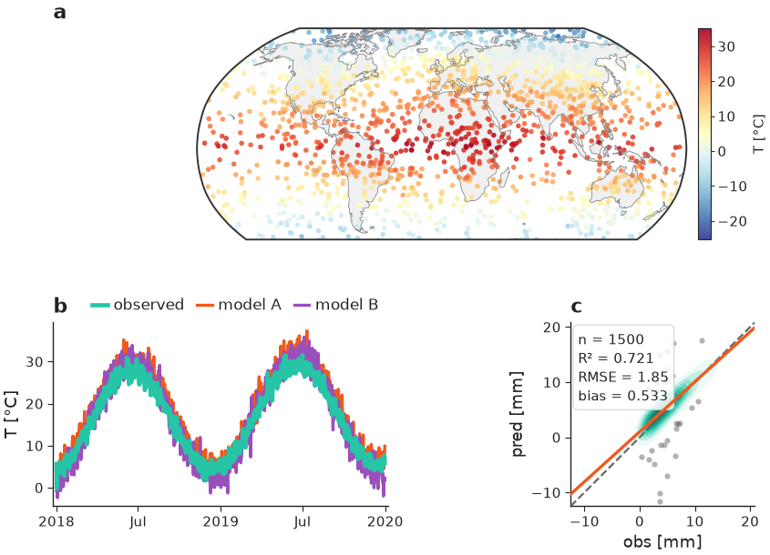
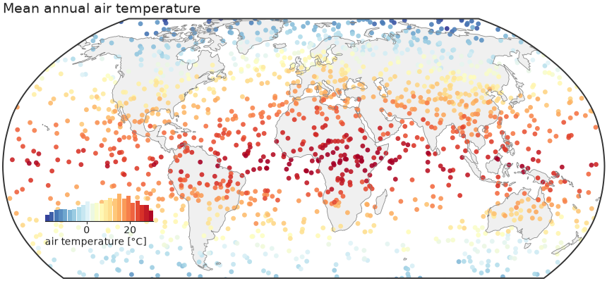

# nicefigs { .visually-hidden }

{ width="400" }

<p align="center"><b>Publication-grade, modular matplotlib plotting for geoscience.</b></p>

`nicefigs` is a thin, composable layer on top of matplotlib. It gives you a
single consistent house style (sans-serif, journal-like), physical
figure sizing that keeps fonts consistent across every panel, and a toolbox of
geoscience-ready plots: global/regional maps, ternary maps & scatters, image
grids, tight colorbars, KDE agreement plots, model-comparison violins,
timeseries, and map animations.



## Design philosophy

**One consistent house style.** A small, explicit [`Theme`][nicefigs.style.Theme]
dataclass bundles font sizes, line widths, and colours. Call
[`nicefigs.set_theme("paper")`][nicefigs.set_theme] once and every helper —
maps, scatter plots, heatmaps, timeseries — renders with matching fonts,
tick sizes, and spine weights.

**Physical figure sizing.** You almost never want to think in inches. You
want "a single-column figure" or "half the text width". Because
font sizes live in *points* and figure sizes live in *inches*,
[`nicefigs.figure`][nicefigs.figure] / [`nicefigs.subplots`][nicefigs.subplots]
solve the figure size from a named physical target (`width="single"`,
`width="half"`, ...) and an aspect ratio. The rendered figure lands at
exactly the requested physical size, with fonts at exactly the theme's point
sizes — so a multi-panel paper figure looks consistent whether one panel is a
map and another is a scatter plot.

**Modular, composable helpers.** Every plotting function accepts an existing
`ax` (or `fig`) where it makes sense, so you can drop nicefigs pieces into
your own matplotlib layouts — a `GridSpec`, a `plt.subplots` grid, an inset
axes — rather than being handed a fixed figure you have to fight with. The
[composite figure](gallery.md#composite) example shows a map, a timeseries,
and an agreement plot composed into one `GridSpec`, all sharing one theme and
one physical width.

## Install

```bash
pip install nicefigs

# with cartopy-backed map projections
pip install "nicefigs[maps]"

# with xarray input helpers
pip install "nicefigs[xarray]"

# both
pip install "nicefigs[all]"
```

## A first example

The figure above is built from three independently composable pieces —
a map, a timeseries, and an agreement plot — arranged in a `GridSpec`, all at
one consistent physical width. See it fully worked through in the
[Gallery](gallery.md#composite) and [Quickstart](quickstart.md).

```python
import nicefigs as nf
from nicefigs import data

nf.set_theme("paper")

lon, lat, temp = data.global_points(field="temperature")
fig, ax, m = nf.map(
    lon, lat, temp,
    cmap="RdYlBu_r",
    colorbar_label="air temperature [°C]",
    title="Mean annual air temperature",
)
nf.save(fig, "figures/global_map", formats=("pdf", "png"))
```



Continue to the [Quickstart](quickstart.md) or browse the full
[Gallery](gallery.md) for every plot family, or jump straight to the
[API Reference](api.md).
