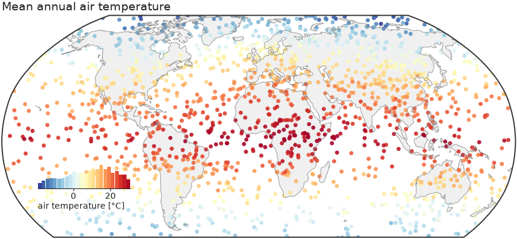
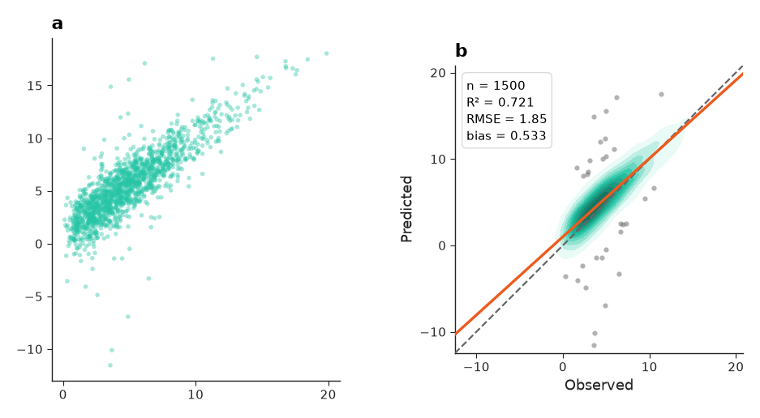
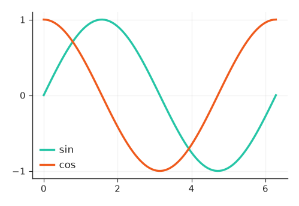

# Quickstart

This page installs nicefigs, draws a first map, saves it, and introduces the
conventions every helper follows.

## Installing

```bash
pip install "nicefigs[maps]"
```

The `maps` extra pulls in `cartopy` and `shapely`, which draw the projected
maps and clip to land. Without it, maps fall back to a plain equirectangular
axes.

## Setting the house style

[`set_theme`][nicefigs.set_theme] applies a theme's `rcParams` globally and
returns the resolved [`Theme`][nicefigs.style.Theme]:

```python
import nicefigs as nf

theme = nf.set_theme("paper")
print(theme.name, theme.fs_axis_label, theme.fs_tick)
```

```text
paper 6.5 5.5
```

Font sizes are in points. The presets range from dense multi-panel `"paper"`
figures to `"talk"` and `"poster"`; see [Styling & themes](guide/styling.md).

## Drawing a first map

[`map`][nicefigs.map] draws a Robinson world map with Antarctica cropped,
scatters the values, and adds an inset histogram that doubles as the colorbar:

```python
import nicefigs as nf
from nicefigs import data

nf.set_theme("paper")
lon, lat, temp = data.global_points(field="temperature")
fig, ax, mappable = nf.map(
    lon, lat, temp,
    cmap="RdYlBu_r",
    colorbar_label="air temperature [°C]",
    title="Mean annual air temperature",
)
```



See [Maps](guide/maps.md) for projections, regional extents and binning.

## Saving figures

[`save`][nicefigs.save] writes one tight file per format, creating parent
directories, and returns the written paths:

```python
import nicefigs as nf

fig, ax = nf.subplots(width="half")
ax.plot([0, 1, 2], [0, 1, 4])
paths = nf.save(fig, "figures/first", formats=("pdf", "png"), close=True)
print([p.as_posix() for p in paths])
```

```text
['figures/first.pdf', 'figures/first.png']
```

Raster formats use the theme's `savedpi` (300 by default); `close=True` closes
the figure once it is written.

## Following the calling conventions

Every helper has one of three shapes:

- **Plotting helpers** draw data onto one axes. They take `ax=None` as a
  keyword and create a figure when it is missing. They return `ax`, or
  `(ax, extra)` when they also produce something you need: the mappable for a
  colorbar, the statistics of an agreement plot, the indices of a Pareto
  frontier.
- **Figure helpers** build a whole figure. They return `(fig, axes)` or
  `(fig, axes, extra)`, always in that order: `map` returns
  `(fig, ax, mappable)`, `animate_maps` returns `(fig, ax, anim)`,
  `model_comparison` returns `(fig, axes)`.
- **Decorators** annotate an axes you already have: panel labels, colorbars,
  legends of 2D colormaps, reference lines, map backgrounds. They take that
  axes as their first, required argument.

```python
import nicefigs as nf
from nicefigs import data

obs, pred = data.xy_agreement()
fig, axes = nf.subplots(1, 2, width="full", panel_aspect=1.0, wspace=0.4)

nf.scatter(obs, pred, ax=axes[0], s=4, alpha=0.4)  # plotting helper
ax, stats = nf.agreement(obs, pred, ax=axes[1])   # plotting helper with an extra
nf.label_panels(axes)                             # decorator
print(sorted(stats))
```

```text
['bias', 'intercept', 'n', 'r2', 'rmse', 'slope']
```



Unit arguments are named `units`, `xunits`, `yunits` or `<thing>_units`.
Wherever a helper asks which way is better, it takes one of
[`DIRECTIONS`][nicefigs.DIRECTIONS]:

```python
import nicefigs as nf

print(nf.DIRECTIONS)
```

```text
('higher_better', 'lower_better', 'target')
```

## Styling existing matplotlib code

[`style`][nicefigs.style.style] applies a theme only inside a `with` block, so
plain matplotlib code picks up the house style without a global change:

```python
import matplotlib.pyplot as plt
import numpy as np

import nicefigs as nf

x = np.linspace(0, 2 * np.pi, 100)
with nf.style("paper", **{"axes.grid": True}):
    fig, ax = plt.subplots(figsize=(2.75, 1.8))
    ax.plot(x, np.sin(x), label="sin")
    ax.plot(x, np.cos(x), label="cos")
    ax.legend()
```



Keyword arguments after the theme name are raw `rcParams` overrides.

## Sizing figures physically

Pick a named width and an aspect ratio instead of inches; the other dimension
is solved:

```python
import nicefigs as nf

w, h = nf.figure_size("single", aspect=0.75)
print(f"{w:.2f} x {h:.2f} in")
```

```text
3.50 x 2.63 in
```

A `"single"` column is 89 mm wide. Named widths also include `"double"`,
`"full"`, `"half"` and `"slide"`; see [Figures & sizing](guide/figures.md) for
the full list.

## Next steps

- Browse the [Gallery](gallery.md) for every plot family with its source code.
- Read the guide, starting at [Styling & themes](guide/styling.md).
- Look up any function in the [API Reference](api.md).
